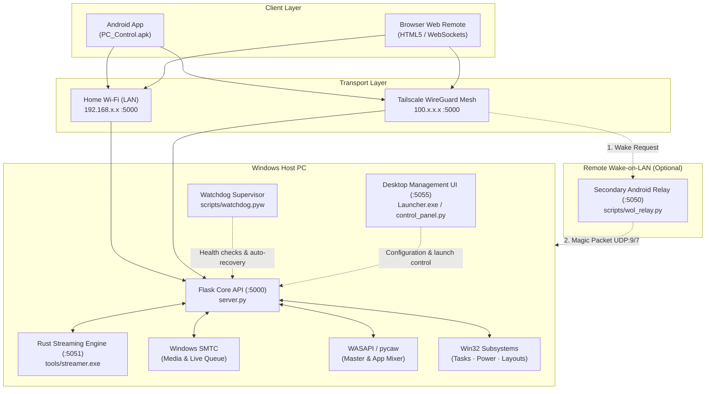

<div align="center">

<p align="center">
  <b>English</b> &nbsp;|&nbsp; <a href="README.ru.md">Русский</a>
</p>

# PC Control

**Self-hosted Windows service and client ecosystem for remote PC administration, media playback, WASAPI audio/DXGI streaming, and Wake-on-LAN from Android and Web.**

[-0078D6?style=flat-square&logo=windows&logoColor=white)](https://microsoft.com/windows)
[](https://github.com/lavi-666/pc-control/actions/workflows/ci.yml)
[](https://github.com/lavi-666/pc-control/releases/latest)
[](https://www.python.org/)
[](https://www.rust-lang.org/)
[](https://github.com/lavi-666/pc-control/releases/latest/download/PC_Control.apk)
[](https://tailscale.com)
[](LICENSE)

<br/>

<p align="center">
  <a href="https://github.com/lavi-666/pc-control/releases/latest/download/PC_Control.apk">
    
  </a>
  &nbsp;&nbsp;
  <a href="https://github.com/lavi-666/pc-control/releases/latest/download/Launcher.exe">
    
  </a>
</p>

<p align="center">
  <sub>Official pre-compiled releases and SHA-256 checksums are published in <a href="https://github.com/lavi-666/pc-control/releases/latest"><b>GitHub Releases</b></a>.</sub>
</p>

</div>

---

## Table of Contents

- [Overview](#overview)
- [Architecture](#architecture)
- [Core Capabilities](#core-capabilities)
- [System Requirements](#system-requirements)
- [Quick Start & Setup](#quick-start--setup)
- [Server Operation](#server-operation)
- [Client Applications](#client-applications)
- [Remote Access & Wake-on-LAN](#remote-access--wake-on-lan)
- [Configuration Reference](#configuration-reference)
- [REST API Reference](#rest-api-reference)
- [Security Model](#security-model)
- [Testing & Quality Assurance](#testing--quality-assurance)
- [Troubleshooting](#troubleshooting)
- [License](#license)

---

## Overview

PC Control provides a private, self-hosted control plane for Windows computers. It allows users to control media playback, adjust system and per-application volume levels, inspect running processes, manage power states, and stream the desktop with system audio directly to a smartphone or web browser.

The system is designed to work out of the box in two networking environments:
1. **Local Network (LAN)**: Operates entirely offline across your home Wi-Fi subnet with zero third-party service dependencies.
2. **Encrypted Mesh (Tailscale / WireGuard)**: Operates globally over private `100.64.0.0/10` virtual addresses without router port forwarding or public static IPs.

The host runs as an asynchronous Python service paired with an embedded Rust capture engine (`tools/streamer.exe`) for hardware-accelerated desktop duplication and loopback audio capture. A background supervisor (`scripts/watchdog.pyw`) maintains process health and provides automated recovery.

---

## Architecture



### Component Breakdown

| Component | Technology | Default Port | Responsibility |
|:---|:---|:---|:---|
| **Core API Server** | Python 3 / Flask | `TCP 5000` | REST API, token authentication, rate limiting, and subsystem routing (`server.py`). |
| **Streaming Microservice** | Rust / DXGI / WASAPI | `TCP 5051` | Hardware desktop duplication, audio loopback capture, and WebRTC streaming (`tools/streamer.exe`). |
| **Watchdog Supervisor** | Python (`watchdog.pyw`) | N/A | Background process monitoring, crash-loop prevention, and health-check recovery. |
| **Desktop Launcher** | C# / Python HTTP server | `TCP 5055` | Local desktop dashboard for network checks, server management, and system setup (`Launcher.exe`). |
| **Android Client** | Java / WebView / OkHttp | Dynamic | Standalone mobile application with background audio streaming support (`PC_Control.apk`). |
| **Web Remote** | HTML5 / JavaScript | `TCP 5000` | Browser-based control panel served directly from the host. |
| **WOL Relay Service** | Python (`wol_relay.py`) | `TCP 5050` | Secondary home device relay for waking powered-off hosts outside the local network. |

### Repository Structure

```text
pc-control/
├── server.py              # Main Flask application entrypoint & Blueprint registry
├── core/                  # Core infrastructure (auth, rate limiting, config, state)
│   ├── auth.py            # Dual-tier token authentication & brute-force lockout
│   ├── config.py          # Configuration management with schema validation
│   └── logger.py          # Structured actions audit & error logger
├── modules/               # Modular business logic blueprints
│   ├── media.py           # SMTC controller & media endpoints dispatcher
│   ├── media_api.py       # YouTube Music Innertube track & queue resolution
│   ├── media_history.py   # Listening history persistence & caching
│   ├── media_keys.py      # Win32 media key injection & window targeting
│   ├── media_queue.py     # Live queue state, playlist syncing & automix
│   ├── media_uia.py       # UI Automation for browser tabs & DOM interaction
│   ├── media_volume.py    # WASAPI per-player session volume control
│   ├── power.py           # Shutdown, restart, sleep & workstation lock
│   ├── presets.py         # Multi-step launch presets with fuzzy app search
│   ├── streaming.py       # Native WebRTC screen & loopback audio proxy
│   ├── system.py          # Task manager, process terminator & layout switcher
│   └── volume.py          # Master system volume & WASAPI per-app mixer
├── web/                   # Web remote client assets & dashboard templates
│   ├── index.html         # Clean semantic HTML5 web client markup (90 KB)
│   ├── css/styles.css     # Client stylesheet & responsive layout (44 KB)
│   ├── js/                # Modular client architecture
│   │   ├── i18n.js        # Multilingual localization dictionaries (uk, ru, en)
│   │   ├── stream.js      # WebRTC audio & screen streaming controllers
│   │   ├── media.js       # Player timeline, active queue & history UI
│   │   ├── presets.js     # Launch presets editor & execution engine
│   │   └── app.js         # Core router, network detection & system UI
│   └── control_panel.html # Desktop Launcher embedded dashboard UI (158 KB)
├── scripts/               # Management & build utilities
│   ├── build_apk.py       # Automated APK compilation with dynamic asset sync
│   ├── control_panel.py   # Desktop management UI server (:5055, 100 KB)
│   └── watchdog.pyw       # Standalone crash-loop watchdog supervisor
├── android_app/           # Android Studio native WebView wrapper project
└── tests/                 # 650-cycle comprehensive regression test suite
```

---

## Core Capabilities

### 1. Media Playback & Live Queue (Windows SMTC)
- Integrates with Windows System Media Transport Controls (`Windows.Media` via WinSDK).
- Bidirectional synchronization with media players, including YouTube Music, Spotify, desktop players, and browser media tabs.
- Reads track metadata: title, artist, album art image, duration, and playback progress.
- Live queue navigation: inspect and select tracks from the active playlist.
- Listening history persistence stored in `listening_history.json`.

### 2. Audio Control & Application Mixer
- Master Windows volume adjustments and mute toggling via Windows Core Audio (WASAPI).
- Per-application audio mixer: enumerates active audio sessions (games, browsers, voice clients) with individual volume sliders and mute controls.
- Thread-safe COM initialization and a cached query layer to eliminate audio API stutter.

### 3. Display & Audio Streaming
- Desktop capture using the native Rust streaming microservice (`tools/streamer.exe`) built on the DirectX Graphics Infrastructure (DXGI) Desktop Duplication API.
- Multi-monitor topology detection with on-the-fly monitor switching.
- WASAPI loopback audio stream delivered via WebRTC (Opus stereo at 48 kHz).
- Supports background audio streaming on Android (audio continues playing when the smartphone screen is locked).

### 4. Process & System Administration
- Live task monitor displaying process ID (PID), process name, and working set memory usage.
- One-click termination for frozen or unresponsive processes (`taskkill` integration).
- Input locale switching: queries and cycles installed Windows keyboard layouts (`WM_INPUTLANGCHANGEREQUEST` / Win32 HKL).
- Append-only actions audit log recorded to `actions_log.jsonl`.

### 5. Power Management & Wake-on-LAN
- Host power actions: shutdown, reboot, sleep (ACPI S3), and lock workstation (`Win+L`).
- Delayed shutdown sleep timer with thread-safe cancellation.
- Local Wake-on-LAN: transmits UDP Magic Packets (ports 7 and 9) across network broadcast addresses.
- Remote Wake-on-LAN: routes wake signals through a secondary relay device (`scripts/wol_relay.py`) on the home subnet.

### 6. Action Sequences (Launch Presets)
- Multi-step automation chains defined in `launch_presets.json`.
- Step types: launch applications (with installed program auto-detection), open URLs, and configurable delay timers between steps.
- Asynchronous chain execution with runtime progress reporting and emergency cancellation.

### 7. Reliability & Watchdog Supervisor
- Standalone background supervisor process (`scripts/watchdog.pyw`) checks server availability every 30 seconds.
- Mutex-guarded single instance execution (`Local\PCControlWatchdogMutex`).
- Auto-restart logic triggered on two consecutive failed health pings.
- Crash-loop protection: limits automatic restarts to a maximum of 5 attempts within a 150-second window.
- Respects clean shutdown requests via `manual_stop.flag`.

---

## System Requirements

### Host PC
- **Operating System**: Windows 10 (version 1809 or later) or Windows 11 (64-bit).
- **Python**: 3.10 or newer (64-bit); Python 3.12 is recommended and was used for the integration audit. Python 3.8/3.9 cannot load the project's evaluated type annotations.
  > [!NOTE]
  > The `winsdk` package provides official pre-built wheels up to Python 3.12. If running on Python 3.13, create a Python 3.11/3.12 virtual environment (`py -3.12 -m venv venv`), which `start_server.bat` detects automatically.
- **Network Adapter**: Ethernet connection recommended for Wake-on-LAN support.

### Clients
- **Android**: Android 8.0 (API level 26) or newer.
- **Web Browser**: Any modern browser supporting HTML5, WebSockets, and WebRTC (Chrome, Edge, Firefox, Safari).

---

## Quick Start & Setup

The project is designed to be fully automated out of the box. You do not need to manually configure virtual environments, run pip commands, or edit configuration files by hand.

### 1. Download the Project
Download the repository as a ZIP archive from GitHub and extract it, or clone via git:
```cmd
git clone https://github.com/lavi-666/pc-control.git
cd pc-control
```

### 2. Launch the Desktop Launcher
Double-click `Launcher.exe` (or run `launcher.bat`):
```cmd
Launcher.exe
```

On first launch, **Launcher.exe automatically performs all setup steps**:
1. **Environment Check**: Detects installed Python interpreters (or offers automatic one-click installation via Windows Package Manager `winget` if Python is not yet installed).
2. **Configuration & Random Token Generation**: Automatically detects your local Wi-Fi IP, Tailscale IP, and physical network adapter MAC address, generating a unique, cryptographically random authentication token (`secrets.token_hex`) and saving it into `config.json`. There are **no static default passwords** (such as `123456789`).
3. **Dependency Installation**: Detects required Python packages and installs them automatically from `requirements.txt` in the background with real-time console progress.
4. **Service Startup & Update Check**: Automatically starts the core API server (`server.py`) on port 5000, launches the watchdog supervisor (`scripts/watchdog.pyw`), and checks GitHub for updates.

> [!IMPORTANT]
> **No Default Credentials**: PC Control does not use static or insecure default passwords. A fresh installation generates a cryptographically random token saved in `config.json`. You can inspect, copy, or change your password anytime directly in the Launcher GUI or via `change_password.exe`.

The dashboard displays your connection URLs, active network addresses, and server controls.

### 3. Connect Clients
- **Web Browser**: Open the displayed URL (`http://<LAN_IP>:5000/`) on your phone or tablet browser and log in with your access token.
- **Android App**: Install `PC_Control.apk` (pre-compiled in the repository root) on your Android device and enter your connection details.

---

### Optional & Advanced Configuration

All parameters can be adjusted directly inside the desktop launcher interface. For headless environments or script-based administration, the following automated tools are also available:

#### Windows Defender Firewall (Recommended for LAN access)
To permit inbound client connections across your home Wi-Fi and Tailscale while isolating the server from untrusted public networks, click **Configure** next to Step 4 in the launcher checklist, or execute:
```cmd
scripts\apply_firewall_rule.bat
```
This administrative script configures an inbound allow rule on TCP port 5000 restricted to `LocalSubnet` and the Tailscale CGNAT subnet (`100.64.0.0/10`).

#### Custom Password & Interactive Configuration Wizard
To change your access password, click **Change** on the password card in the launcher GUI. Alternatively, run the interactive command-line wizard:
```cmd
scripts\configure.bat
```

#### Manual Dependency Installation (CLI)
If running on a headless server or custom Python virtual environment without the desktop launcher:
```cmd
python -m pip install --upgrade pip
pip install -r requirements.txt
```

---

## Server Operation

### Method 1: Desktop Management Console (GUI)
Launch the graphical management interface:
```cmd
Launcher.exe
```
*(Or run `launcher.bat`)*

This starts the desktop control service on `http://127.0.0.1:5055` and opens a dedicated application window. The dashboard displays server status, detected IP addresses, active Tailscale peers, and provides controls to start/stop the server, review live console logs, and inspect Windows sign-in settings.

Key launcher capabilities include:
- **Automatic Startup Update Checks**: On startup, the launcher queries the official GitHub repository for updates. If a newer build is available, a dismissible non-intrusive banner appears: *"A new version of PC Control is available"*, with an **Update Now** button and an **✕** dismiss button.
- **Manual Update Checks**: Clicking *"Check for Updates"* verifies availability and reports *"You are currently using the latest version."* when up to date.
- **Detached In-Place Updater**: Clicking **Update Now** downloads the latest executable directly from GitHub, validates Portable Executable (PE) header integrity (`MZ` magic and `PE\0\0` headers), and invokes `scripts/updater.bat`. The updater process waits for the launcher to exit, safely swaps the executable, and relaunches the application.
- **Browser Profile & Cache Cleaner**: One-click cleanup utility for temporary browser profiles and web cache files.
- **Token Rotation**: Secure one-click generation and rotation of the access token without restarting the system.

### Method 2: Headless Background Service
To run the server quietly in the background without keeping a terminal open:
- **Start**: Run `start_server.bat` (or `scripts\3_start_server.bat`). Launches both `server.py` and `scripts\watchdog.pyw`.
- **Stop**: Run `stop_server.bat`. Gracefully terminates `server.py`, `watchdog.pyw`, and `tools\streamer.exe`.
- **Foreground / Debugging**:
  ```cmd
  python server.py
  ```

---

## Client Applications

### Web Client
Open a web browser on any device connected to your local network or Tailscale mesh and navigate to:
```text
http://<HOST_IP>:5000/
```
Enter the authentication token configured in `config.json`.

### Android Application
1. Install `PC_Control.apk` on your Android device (located in the repository root).
2. Launch the app and enter the server URL (`http://192.168.x.x:5000` or `http://100.x.x.x:5000`) and authentication token.
3. To generate a custom APK with your personal IP and token pre-configured:
   ```cmd
   python scripts/build_apk.py
   ```
   The build script uses the embedded Android toolchain in `.android_sdk` (aapt2, d8, zipalign, apksigner) to compile, package, and sign a standalone APK without requiring Android Studio.

---

## Remote Access & Wake-on-LAN

### Remote Access via Tailscale
To control your PC outside your home network without port forwarding or dynamic DNS:
1. Install [Tailscale](https://tailscale.com) on the host PC (using `tailscale-setup-1.102.4.exe` or official download).
2. Install Tailscale on your smartphone from Google Play or the App Store.
3. Sign in to the same account on both devices.
4. Use the assigned Tailscale IPv4 address (`100.x.x.x`) in the client application. All traffic is end-to-end encrypted using WireGuard.

### Wake-on-LAN Configuration

#### 1. Motherboard BIOS/UEFI Settings
Enable standby power to the Ethernet controller:
- Set **Wake on LAN**, **Resume by Onboard LAN**, or **Resume by PCI-E Device** to **Enabled**.
- Set **ErP Ready** / **Deep Sleep** to **Disabled** (ErP shuts off standby power to the network interface when the computer is turned off).

#### 2. Windows Network Adapter & Autologon
Run the automated configuration script as Administrator:
```cmd
scripts\2_setup_autologon.cmd
```
The script performs the following setup:
- Configures network adapter driver parameters (`*WakeOnMagicPacket = 1`).
- Disables Windows Fast Startup (`HiberbootEnabled = 0`), which prevents Windows from cutting NIC power during shutdown.
- Adds the server startup shortcut to the Windows Startup folder.
- Configures `DevicePasswordLessBuildVersion = 0` in the registry and launches `netplwiz` for automatic user logon.

> [!IMPORTANT]
> When configuring automatic logon in `netplwiz`, supply your **actual Windows / Microsoft Account password**, not a 4-digit Windows Hello PIN. Using a PIN will cause automatic sign-in to fail upon reboot.

#### 3. Remote Wake Relay (Outside Home)
Because a shut-down computer cannot maintain a VPN connection, remote wake requests must be received by a device on your home network:
1. Run `scripts/wol_relay.py` on a secondary device permanently connected to your home Wi-Fi (such as an older Android phone running Termux or a mini-PC).
   ```bash
   python scripts/wol_relay.py
   ```
2. The relay listens on port `5050`. In the client application, specify the relay's Tailscale address (e.g. `http://100.64.0.2:5050`).
3. Tapping the power-on button sends a wake command to the relay, which broadcasts raw UDP Magic Packets across the local subnet.

---

## Configuration Reference

Configuration parameters are stored in `config.json` in the project root:

```json
{
  "token": "your_secure_password_here",
  "lan_ip": "192.168.0.100",
  "vpn_ip": "100.64.0.1",
  "wol_relay_ip": "100.64.0.2",
  "mac_address": "AA-BB-CC-DD-EE-FF",
  "port": 5000,
  "relay_port": 5050,
  "language": "en",
  "cors_allowed_origins": [
    "http://localhost:*",
    "http://127.0.0.1:*",
    "http://192.168.*",
    "http://100.*",
    "http://10.*"
  ]
}
```

| Field | Type | Default | Description |
|:---|:---|:---|:---|
| `token` | `string` | *(generated)* | Shared secret authentication token. Cryptographically generated on first run (`secrets.token_hex`). No static default password. Passed in `X-Auth-Token` header, HTTP-only cookie, or verified at `/api/auth/login`. |
| `lan_ip` | `string` | `"192.168.0.101"` | Primary IPv4 address of the host machine on the local network. |
| `vpn_ip` | `string` | `""` | Tailscale IPv4 address assigned to the host machine. |
| `wol_relay_ip` | `string` | `""` | Tailscale IPv4 address of the secondary relay device for remote Wake-on-LAN. |
| `mac_address` | `string` | `"AA-BB-CC-DD-EE-FF"` | Hardware MAC address of the physical Ethernet adapter used for Magic Packets. |
| `port` | `integer` | `5000` | TCP port for the primary Flask server and web client. |
| `relay_port` | `integer` | `5050` | TCP port for the Wake-on-LAN relay service (`wol_relay.py`). |
| `language` | `string` | `"en"` | Interface language code (`"en"`, `"ru"`, `"uk"`). |
| `cors_allowed_origins` | `array` | `["http://localhost:*", ...]` | Allowed HTTP Origin headers for CORS protection. Supports wildcard subnets for trusted local LAN and Tailscale mesh addresses. |

To change only the authentication password at any time, run:
```cmd
change_password.exe
```
*(Or run `change_password.bat`)*

---

## REST API Reference

All state-altering requests require authentication via the `X-Auth-Token` HTTP header or a `token` JSON property in the request body.

### System & Health

| Method | Endpoint | Description |
|:---|:---|:---|
| `GET` | `/status` | Returns system telemetry, CPU/RAM utilization, current volume, active media, and server uptime. |
| `GET` | `/health` | Minimal health check endpoint used by the supervisor process. |
| `GET` | `/actions/log` | Returns the recent actions audit trail. |

### Audio & Volume

| Method | Endpoint | Payload Example | Description |
|:---|:---|:---|:---|
| `GET` | `/volume` | N/A | Returns master volume percentage and mute status. |
| `POST` | `/volume` | `{"percent": 45}` | Sets the system master volume level (0–100). |
| `GET` | `/app_volumes` | N/A | Returns a list of active per-application audio sessions. |
| `POST` | `/app_volume` | `{"pid": 4820, "percent": 70}` | Sets the volume level for a specific application process. |
| `POST` | `/app_volume/mute` | `{"pid": 4820, "mute": true}` | Toggles mute on an application audio session. |

### Media Player (SMTC)

| Method | Endpoint | Payload Example | Description |
|:---|:---|:---|:---|
| `GET` | `/media/status` | N/A | Returns playback status, track metadata, and album art URI. |
| `POST` | `/media/play_pause` | N/A | Toggles play/pause state. |
| `POST` | `/media/next` | N/A | Skips to the next track in the active media player. |
| `POST` | `/media/prev` | N/A | Skips to the previous track. |
| `GET` | `/media/queue` | N/A | Returns the current track list from the active player session. |
| `POST` | `/media/play_index` | `{"index": 3}` | Jumps to a specific track index in the active queue. |
| `GET` | `/media/history` | N/A | Returns local playback history. |

### Process Management & System Controls

| Method | Endpoint | Payload Example | Description |
|:---|:---|:---|:---|
| `GET` | `/processes` | N/A | Lists running user processes sorted by memory usage. |
| `POST` | `/process/kill` | `{"pid": 10240}` | Forcefully terminates a process by PID. |
| `GET` | `/keyboard/layout` | N/A | Returns active and installed Windows keyboard layouts. |
| `POST` | `/keyboard/toggle` | N/A | Cycles to the next installed keyboard layout. |

### Power & Power Timers

| Method | Endpoint | Payload Example | Description |
|:---|:---|:---|:---|
| `POST` | `/power/shutdown` | N/A | Initiates an immediate system shutdown. |
| `POST` | `/power/restart` | N/A | Initiates an immediate system restart. |
| `POST` | `/power/sleep` | N/A | Puts the system into sleep mode (ACPI S3). |
| `POST` | `/power/lock` | N/A | Locks the active Windows session (`LockWorkStation`). |
| `POST` | `/power/sleep_timer` | `{"minutes": 45}` | Schedules a delayed shutdown. |
| `POST` | `/power/cancel_timer` | N/A | Cancels an active sleep timer. |

### Streaming & Automation

| Method | Endpoint | Payload Example | Description |
|:---|:---|:---|:---|
| `POST` | `/stream/offer` | `{"sdp": "...", "type": "offer"}` | WebRTC SDP handshake for desktop video/audio stream. |
| `GET` | `/presets` | N/A | Returns saved application launch routines. |
| `POST` | `/presets/run` | `{"id": "preset_gaming"}` | Executes a configured automation sequence. |

---

## Security Model

- **Zero Hardcoded Credentials**: PC Control does not contain static default passwords (such as `123456789`). Every installation automatically generates a unique, cryptographically random 128-bit authentication token (`secrets.token_hex`) on initial startup and stores it in `config.json`.
- **Constant-Time Verification**: All token comparisons use `secrets.compare_digest` to eliminate timing side-channel analysis.
- **Two-Tier Brute-Force Rate Limiting & IP Lockout**:
  - Evaluation window: **120 seconds** (`LOCKOUT_WINDOW = 120s`).
  - **External / Public IP Addresses**: Exceeding **5 failed attempts** within 120 seconds triggers an immediate **180-second (3-minute)** IP lockout (`LOCKOUT_MAX_ATTEMPTS = 5`, `LOCKOUT_DURATION = 180s`).
  - **Trusted Local & Mesh Networks** (RFC 1918 subnets `192.168.0.0/16`, `10.0.0.0/8`, `172.16.0.0/12`, loopback `127.0.0.1`, and Tailscale CGNAT `100.64.0.0/10`): Threshold is set to **15 failed attempts** within 120 seconds, with a brief cooldown of **30 seconds** (`LOCKOUT_LAN_MAX = 15`, `LOCKOUT_LAN_DURATION = 30s`).
  - *Dual-tier rationale*: The relaxed threshold on trusted private subnets prevents accidental lockouts and lock-in loops for legitimate household smartphones and family members due to typos or stale cached app tokens, while preserving aggressive throttling against scans from untrusted interfaces.
  - **Persistent Cooldowns**: Active lockouts are persisted to disk in `logs/lockouts.json`, ensuring temporary blocks survive server restarts.
  - **Immediate Reset**: A successful authentication immediately clears the failure counter for that IP. Changing the password via the Launcher GUI or `change_password.exe` flushes all active lockouts across all addresses.
- **Strict Environment-Only Test Isolation**:
  - Test and safe modes cannot be enabled or forged via client HTTP headers (e.g. `X-Safe-Mode`).
  - Test mode is strictly bound to process environment variables (`PC_CONTROL_TEST_MODE=1` or `SAFE_TEST_MODE=1`), preventing unauthorized external clients from spoofing test flags or bypassing security gates.
- **Fine-Grained CORS Whitelisting**:
  - Inbound HTTP `Origin` headers are strictly validated against `cors_allowed_origins` in `config.json`.
  - Supports wildcard subnet patterns (`http://localhost:*`, `http://192.168.*`, `http://100.*`, `http://10.*`) for local LAN and Tailscale access. Requests from unauthorized origins are rejected with HTTP 403 Forbidden.
- **PE Header Binary Integrity Verification**:
  - Updates downloaded via the GitHub updater undergo strict validation of Portable Executable (PE) headers (`MZ` magic bytes and `PE\0\0` signature offset) before replacing running binaries.
- **Network Profile Isolation**:
  - Windows Defender Firewall rules explicitly bind TCP port 5000 access to `Private` network profiles, permitting only `LocalSubnet` and `100.64.0.0/10`. Inbound packets from arbitrary public IP addresses are blocked at the packet filter.
- **Transport Encryption**:
  - Remote connections routed through Tailscale are encapsulated in point-to-point WireGuard tunnels using ChaCha20-Poly1305 and Curve25519 cryptography.

---

## Testing & Quality Assurance

The repository includes a comprehensive 650-cycle regression test suite covering all functional modules:

```cmd
python tests/run_all_650_tests.py
```

The test runner executes 26 modular batches:
1. Core API contracts & authentication headers
2. Boundary values & parameter clamping
3. Malformed data handling, SQLi & XSS injection resilience
4. Wake-on-LAN packet generation & relay communication
5. Environment validation & error responses
6. Concurrency stress & thread contention
7. Windows SMTC media transport controls
8. Audio subsystem & WASAPI loopback capture
9. WebRTC SDP signaling & display topology
10. Win32 keyboard layout switching
11. Process manager enumeration & termination
12. Audit persistence & log rotation
13. Subnet broadcast packet transmission
14. HTTP protocol adherence & MIME types
15. Path traversal protection & auth lockouts
16. CORS header validation
17. Numerical extremes (NaN, Infinity, float overflows)
18. Static asset range requests
19. Low-level TCP socket lifecycle & reset handling
20. OkHttp mobile client network emulation
21. Per-application audio session edge cases
22. Mixed-workload lock contention
23. Request smuggling & fault injection
24. Memory consumption & resource leak profiling
25. Multi-pass deterministic fuzzing
26. Cross-subsystem invariant verification

To run an individual test batch directly:
```cmd
python tests/test_batch_08.py
```

---

## Troubleshooting

### Client Cannot Connect over Local Wi-Fi
- Verify your Windows network connection is set to **Private network** (Settings → Network & internet → Properties). Windows blocks inbound connections on Public networks.
- Re-apply the firewall rule by running `scripts\apply_firewall_rule.bat` as Administrator.
- Confirm the client and host are connected to the same router subnet (not isolated guest networks).

### Computer Prompts for Password or PIN after Wake-on-LAN
- Run `scripts\2_setup_autologon.cmd` as Administrator.
- In the `netplwiz` dialog, uncheck *«Users must enter a user name and password»*, click **Apply**, and enter your **full account password** (not a Windows Hello PIN).
- Confirm the registry key `HKLM\SOFTWARE\Microsoft\Windows NT\CurrentVersion\PasswordLess\Device\DevicePasswordLessBuildVersion` is set to `0`.

### Computer Does Not Wake from Shutdown
- Enter BIOS/UEFI settings and confirm **Wake on LAN** / **Resume by PCI-E Device** is enabled and **ErP Ready** is disabled.
- Check that the physical Ethernet port LED remains illuminated after shutdown.
- Run the diagnostic script in a terminal:
  ```cmd
  python tools/diag_wol.py
  ```

### `winsdk` Installation Issue on Python 3.13
- The `winsdk` package provides wheels for Python 3.8 through 3.12.
- For Python 3.13 systems, create a Python 3.11/3.12 virtual environment:
  ```cmd
  py -3.12 -m venv venv
  venv\Scripts\pip install -r requirements.txt
  ```
  `start_server.bat` automatically checks for and uses a `venv` directory if present.

### Compiling Native Streaming Engine from Source
To rebuild `tools/streamer.exe` from the Rust source code:
```cmd
cd streamer_rs
cargo build --release
copy target\release\streamer.exe ..\tools\streamer.exe
```

---

## License

This project is licensed under the MIT License. See the [LICENSE](LICENSE) file for details.
