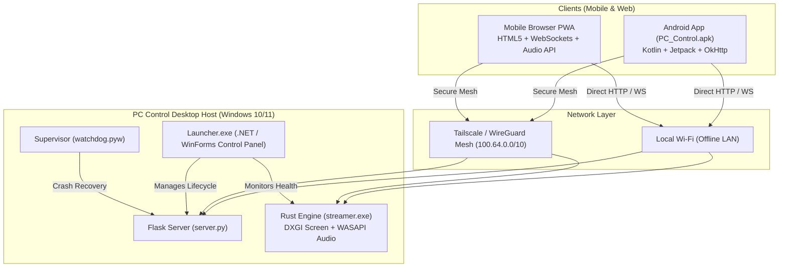

<div align="center">


# PC Control

**Fast, private, cloud-free Windows remote control and media streaming from your phone or browser.**

[-0078D6?style=flat-square&logo=windows&logoColor=white)](https://microsoft.com/windows)
[](https://github.com/lavi-666/pc-control/actions/workflows/ci.yml)
[](https://github.com/lavi-666/pc-control/releases/latest)
[](tests/)
[](streamer_rs/)
[](runtime/)
[](LICENSE)

<br/>

<p align="center">
  <a href="https://github.com/lavi-666/pc-control/releases/latest/download/PC-Control-Setup.exe">
    
  </a>
  &nbsp;&nbsp;
  <a href="https://github.com/lavi-666/pc-control/releases/latest/download/PC_Control.apk">
    
  </a>
  &nbsp;&nbsp;
  <a href="https://github.com/lavi-666/pc-control/releases/latest/download/PC_Control_Windows.zip">
    
  </a>
</p>

<p align="center">
  <b>English</b> &nbsp;•&nbsp; <a href="README.ru.md">Русский</a> &nbsp;•&nbsp; <a href="README.old.md">Archived Old Readme</a>
</p>

</div>

---

## ⚡ Why PC Control?

Most remote desktop utilities (TeamViewer, AnyDesk) require internet connectivity, cloud accounts, third-party relays, and heavy background services.

**PC Control is built differently:**
- 🔒 **100% Private & Local**: Works directly over your local Wi-Fi. Zero telemetry, no cloud accounts, no third-party servers.
- ⚡ **High-Performance Streaming**: Hardware-accelerated desktop capture via **DirectX DXGI** and low-latency audio capture via **Windows WASAPI Loopback** powered by an embedded native Rust engine.
- 📱 **Dual Client Ecosystem**: Native lightweight Android app (390 KB) or an instant, mobile-optimized Progressive Web App (PWA) opened via a QR code.
- 🎛️ **Granular Windows Administration**: Media SMTC playback control (Spotify, YouTube, VLC), per-application audio mixer faders, task manager process inspection, keyboard layout toggling, and scheduled timers.
- 💤 **Remote Power & Wake-on-LAN**: Turn on your PC from complete shutdown over Wi-Fi (including multi-subnet UDP relay), put to sleep, reboot, or schedule shutdown.
- 📦 **Single-Click Setup**: Ships with a standalone installer `PC-Control-Setup.exe` with bundled Python runtime. No need to install Python, Rust, Git, or SDKs manually.

---

## 📊 Feature Comparison

| Feature | **PC Control** | RustDesk | TeamViewer / AnyDesk | Unified Remote |
| :--- | :---: | :---: | :---: | :---: |
| **Direct Offline LAN Operation** | **Yes** (100% offline) | Relay or LAN | No (Cloud required) | Yes |
| **No Cloud Account / Login Required** | **Yes** (Pair via QR) | Yes | No | Yes |
| **Web Browser Client (Zero Install)** | **Yes** (Responsive PWA) | WebClient (Beta) | Web (Account required) | No |
| **Low-latency WASAPI Audio Streaming** | **Yes** (Rust engine) | Stereo audio | Compressed VOIP | No audio stream |
| **Per-App Volume Mixer** | **Yes** | No | No | Limited |
| **Wake-on-LAN + Subnet Relay** | **Yes** (Built-in) | WoL only | WoL (Complex) | WoL only |
| **One-Click Windows Installer** | **Yes** (1.40 MB) | Yes | Yes | Yes |
| **Autonomous Clean Uninstaller** | **Yes** (Rollback journal) | Generic | Generic | Generic |
| **License** | **MIT (Open Source)** | AGPL-3.0 | Proprietary ($$$) | Proprietary |

---

## 🚀 Quick Start (Up & Running in 60 Seconds)

### 📦 Choose Your Download Format

PC Control is available in **three formats** — in every case everything after that is done in the app window: no console, no BAT files, no JSON editing:

| Format | File | Recommended For | How to Launch |
| :--- | :--- | :--- | :--- |
| **1. Windows Setup Wizard** *(Recommended)* | [`PC-Control-Setup.exe`](https://github.com/lavi-666/pc-control/releases/latest/download/PC-Control-Setup.exe) | Most desktop users | Download, run setup wizard, pick directory, click Install. Creates desktop & start menu shortcuts, registers in Windows Add/Remove Programs. |
| **2. Portable ZIP Folder** *(No installation)* | [`PC_Control_Windows.zip`](https://github.com/lavi-666/pc-control/releases/latest/download/PC_Control_Windows.zip) | Portable use / USB drive | Download ZIP, extract to **any directory** on your PC and run `Launcher.exe`. Leaves no system changes; to remove, simply delete the folder. |
| **3. Source code from GitHub** | **Code → Download ZIP** on the repository page | Latest version | Extract to any folder (spaces and non-Latin characters in the path are fine) and run `Launcher.exe`. On first start it downloads an isolated Python into `runtime\` (checksum verified) and installs the libraries — needs internet, usually 1–3 minutes. |

---

### Connect with Your Phone

1. **Run `Launcher.exe`** (or the PC Control shortcut). On first start the **setup wizard** opens by itself and checks — and fixes where possible — each step in turn:
   - **Components** — installs missing libraries (progress is shown in the panel console);
   - **Network** — detects the PC's local IP address;
   - **Server** — starts it; if port 5000 is taken by another program or reserved by Windows, a free port is chosen and saved automatically;
   - **Windows Firewall** — explains why the rule is needed and creates it after you agree (Windows asks for administrator confirmation); it only counts as done when the rule really exists;
   - **Network access** — checks that the server answers on its network address.

   If a step fails the wizard stops, shows the reason and a **Retry** button. Reopen it any time with the **Setup wizard** button in the **Setup & Readiness** section.
2. **Connect Phone**:
   - **Option A (Web App)**: Scan the QR code with your phone camera to instantly open the remote in Safari, Chrome, or Firefox.
   - **Option B (Android APK)**: Install [`PC_Control.apk`](https://github.com/lavi-666/pc-control/releases/latest/download/PC_Control.apk) on Android (8.0+) and scan the QR code to pair.

🎉 **You are now in full control of your PC!**

---

## 🎯 Key Capabilities

### 🖥️ Real-Time Screen & Audio Mirroring
- **Hardware-accelerated capture**: DirectX DXGI Desktop Duplication with dynamic resolution scaling (720p, 1080p, 2K) and adaptive framerates (30 / 60 FPS).
- **WASAPI loopback audio**: Micro-streams high-fidelity system sound directly to your phone speakers or headphones.
- **Low latency**: WebRTC / WebSocket low-jitter transport engineered in Rust (`streamer.exe`).

### 🎵 Media Controller & Per-App Mixer
- **Windows SMTC integration**: Real-time track information, artist, title, playback state (Play/Pause/Skip), and timeline position for Spotify, Apple Music, YouTube, VLC, Yandex Music, and media browsers.
- **Per-Application Volume Faders**: Adjust volume or mute individual programs (e.g. lower Discord or browser volume without touching your game).

### 🔌 Power Management & Wake-on-LAN
- **Wake-on-LAN**: Turn on your computer from a cold shutdown via magic packets. Supports cross-subnet broadcast relay for isolated Wi-Fi / Guest VLAN networks.
- **Sleep, Reboot & Shutdown**: One-tap power actions with safety confirmation.
- **Shutdown Timer**: Set a timer (e.g., 45 minutes) to turn off your PC automatically while falling asleep to movies or music, with a cancel countdown.

### 🛠️ Process Manager & System Controls
- **Process Inspection**: View active programs with CPU and memory footprint.
- **Safe Task Termination**: Terminate hanging applications directly from your phone.
- **Keyboard Layout Switcher**: Instantly switch Windows input language (RU/EN/UA) from the remote interface.

---

## 🏗️ System Architecture



---

## 🔒 Security Model

PC Control is built from the ground up for zero-trust local network operation:

- **Constant-Time Token Validation**: Authentication tokens are verified using `secrets.compare_digest` to prevent side-channel timing attacks.
- **Strict Network Lockout**: Automatic brute-force protection with adaptive IP rate limiting (15 attempts on LAN, 5 attempts on public interfaces).
- **No Third-Party Cloud Dependency**: Passwords and tokens never leave your home machine. No external servers or telemetry trackers are contacted.
- **Safe Test Mode**: Security safeguards and destructive commands cannot be bypassed through client HTTP headers; test modes require local OS environment variables.
- **Path Traversal & Injection Shield**: All file endpoints enforce canonical path boundaries (`..` and null-byte rejection).

---

## 📦 Standalone Installer (PC-Control-Setup.exe)

For maximum deployment convenience, PC Control is distributed as a single standalone executable [`PC-Control-Setup.exe`](PC-Control-Setup.exe) (1.40 MB):

- **Architecture**: Written in C# ([`scripts/Installer.cs`](scripts/Installer.cs)) using Windows Forms, compiled via the standard Windows `csc.exe` compiler without third-party dependencies using [`scripts/build_installer.py`](scripts/build_installer.py).
- **Embedded Payload**: All application distribution files (server, web UI, Rust streamer, runtime, and `Uninstall.exe`) are compressed and embedded directly into the installer as a `DeflateStream` resource.
- **GUI Wizard**: Dark-themed modern setup wizard, customizable destination folder (`%LocalAppData%\Programs\PC Control` by default), desktop & start menu shortcut checkboxes, real progress bar.
- **Silent CLI Mode**:
  ```powershell
  # Fully unattended background installation:
  .\PC-Control-Setup.exe /SILENT /DIR="C:\Games\PC Control" /NORUN
  ```
- **Windows Integration**: Creates a standard uninstall entry in `HKCU\Software\Microsoft\Windows\CurrentVersion\Uninstall\PC Control` for easy removal via Windows Settings $\rightarrow$ Installed Apps.
- **Inno Setup Script**: Includes an official Inno Setup 6.x configuration [`scripts/installer.iss`](scripts/installer.iss) for building alternate setups on CI/CD runners.

---

## 🧹 Clean Uninstaller (Uninstall.exe)

PC Control includes an autonomous uninstaller (`Uninstall.exe`) that ensures your system remains as clean as before installation:

- **Process Safety**: Only stops processes spawned from its own installation folder.
- **Registry & Firewall Reversal**: Completely removes Windows `Add/Remove Programs` registrations and custom Windows Firewall rules.
- **State Journal Rollback**: Inspects `system_state_journal.json` to safely revert system settings.
- **Conflict Handling**: Provides `--conflict-policy keep|restore` to avoid overwriting settings modified by other utilities.
- **Clean Self-Deletion**: Removes `%LOCALAPPDATA%\Programs\PC Control`, `%LOCALAPPDATA%\PCControl`, and deletes its own executable.

```powershell
# Interactive uninstaller wizard:
.\Uninstall.exe

# Completely silent uninstallation:
.\Uninstall.exe --silent --conflict-policy restore
```

---

## 🧪 Testing & Quality Assurance

Every release undergoes exhaustive regression and acceptance testing:

- **Installer & Lifecycle Tests**:
  - [`tests/test_installer.py`](tests/test_installer.py): Automated end-to-end testing of `PC-Control-Setup.exe`, file extraction, registry registration in Cyrillic paths with spaces, and subsequent clean uninstallation.
  - [`tests/test_uninstall_and_lifecycle.py`](tests/test_uninstall_and_lifecycle.py): 7 sandbox acceptance scenarios validating unmodified settings, rollbacks, conflict policies, corrupted journals, idempotency, and process safety.
- **650-Cycle Automated Matrix**: Covers 26 specialized test batches:
  ```powershell
  python tests/run_all_650_tests.py
  # Result: ALL 650/650 CYCLES PASSED (100% REGRESSION STABILITY)
  ```
- **98 Unit & Integration Tests**:
  ```powershell
  python -m unittest discover -s tests -p "test_*.py"
  # Result: Ran 98 tests in 52.5s OK
  ```

---

<details>
<summary><b>⚙️ Configuration Reference (config.json)</b> (Click to expand)</summary>

<br/>

The configuration file `config.json` is automatically generated on first launch:

```json
{
  "auto_network": true,
  "token": "6d1a91811a8d1dc3",
  "lan_ip": "192.168.1.100",
  "vpn_ip": "100.90.144.13",
  "wol_relay_ip": "",
  "mac_address": "D8-43-AE-18-30-25",
  "port": 5000,
  "relay_port": 5050,
  "language": "ru",
  "cors_allowed_origins": [
    "http://localhost:*",
    "http://127.0.0.1:*",
    "http://192.168.*",
    "http://100.*"
  ]
}
```

| Parameter | Type | Default | Description |
| :--- | :---: | :---: | :--- |
| `token` | string | Auto-generated | 16-character hex token required in `X-Auth-Token` or cookie. |
| `port` | integer | `5000` | Port for the HTTP REST and Web interface. |
| `relay_port` | integer | `5050` | Port for the Wake-on-LAN broadcast relay service. |
| `auto_network` | boolean | `true` | Automatically detect active Wi-Fi and Tailscale IP addresses on boot. |
| `language` | string | `"ru"` | Default interface language (`"ru"`, `"en"`, `"uk"`). |
| `cors_allowed_origins` | list | `["..."]` | Allowed CORS origins for browser security. |

</details>

---

<details>
<summary><b>🌐 REST API Quick Reference</b> (Click to expand)</summary>

<br/>

All API requests (except public `/status` and `/login`) require the `X-Auth-Token` header or `pc_token` cookie.

| Method | Endpoint | Description |
| :--- | :--- | :--- |
| `GET` | `/status` | Server health, hostname, and instance identity. |
| `GET` / `POST` | `/volume` | Read current master volume or set volume level (`{"percent": 50}`). |
| `GET` / `POST` | `/volume/apps` | List per-application audio sessions or set individual app volume. |
| `GET` / `POST` | `/media` | Get currently playing track metadata or dispatch playback controls. |
| `GET` | `/screen/monitors` | List available monitors and display topologies. |
| `POST` | `/screen/config` | Configure streaming resolution (`height`) and target framerate (`fps`). |
| `GET` / `POST` | `/processes` | List running processes or terminate by PID (`/processes/kill`). |
| `POST` | `/power/sleep` | Put computer into sleep mode (suspend). |
| `POST` | `/power/reboot` | Reboot Windows host. |
| `POST` | `/power/shutdown` | Shut down Windows host. |
| `POST` | `/power/timer` | Schedule automatic shutdown in $N$ minutes. |
| `POST` | `/wake` | Send Wake-on-LAN magic packet to target MAC address. |

</details>

---

<details>
<summary><b>🛠️ Building from Source</b> (Click to expand)</summary>

<br/>

### Prerequisites
- Windows 10 or 11 (x64)
- Python 3.12+ (or bundled `runtime/`)
- Microsoft .NET Framework 4.5+ (included in Windows)
- *(Optional)* Rust & Cargo (to recompile `streamer_rs`)
- *(Optional)* Android SDK & JDK 17 (to recompile `PC_Control.apk`)

### Build Commands
```powershell
# 1. Compile Desktop Launcher (Launcher.exe):
csc /target:winexe /out:Launcher.exe /win32icon:pc_control.ico /r:System.Windows.Forms.dll,System.Drawing.dll scripts/Launcher.cs

# 2. Compile Autonomous Uninstaller (Uninstall.exe):
csc /target:winexe /out:Uninstall.exe /win32icon:pc_control.ico /r:System.Windows.Forms.dll,System.Drawing.dll scripts/Uninstall.cs

# 3. Build One-Click Setup Installer (PC-Control-Setup.exe):
python scripts/build_installer.py

# 4. Compile Android APK (PC_Control.apk):
python scripts/build_apk.py

# 5. Compile Rust Screen Streamer (tools/streamer.exe):
cd streamer_rs
cargo build --release
Copy-Item target/release/streamer_rs.exe ../tools/streamer.exe
```

</details>

---

## ❓ Frequently Asked Questions

<details>
<summary><b>Can I control my PC when I am away from home?</b></summary>
Yes! Simply install <a href="https://tailscale.com">Tailscale</a> on your Windows PC and your smartphone. PC Control automatically detects the Tailscale <code>100.64.0.0/10</code> IP address and exposes the web interface securely over WireGuard encryption without port forwarding.
</details>

<details>
<summary><b>My phone cannot connect to the server. What should I check?</b></summary>
1. Verify both your phone and PC are connected to the same Wi-Fi router.<br/>
2. Ensure your Wi-Fi router does not have "AP Isolation" / "Client Isolation" enabled.<br/>
3. Run the **Setup wizard** in the panel — it checks the server, firewall and network access and shows which step fails. The port number is shown in the panel header ("Server online (port …)").<br/>
4. Turn off any VPN on the PC (except Tailscale) and check that a third-party antivirus/firewall does not block incoming connections.
</details>

<details>
<summary><b>Does PC Control send any data to external servers?</b></summary>
No. PC Control contains zero analytics, telemetry, or remote callbacks. All communications are strictly peer-to-peer between your phone and your PC.
</details>

---

## 📄 License

This project is open-source software licensed under the [MIT License](LICENSE).  
Contributions, feature requests, and bug reports are welcome via [GitHub Issues](https://github.com/lavi-666/pc-control/issues).
