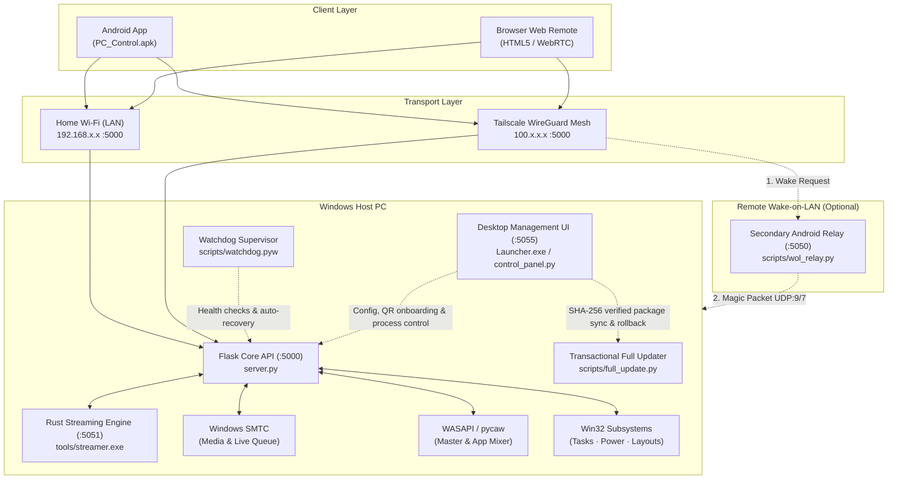

<div align="center">

<p align="center">
  <b>English</b> &nbsp;|&nbsp; <a href="README.ru.md">Русский</a>
</p>

# PC Control

**Self-hosted Windows service and client ecosystem for remote PC administration, media playback, WASAPI audio/DXGI streaming, and Wake-on-LAN from Android and Web.**

[-0078D6?style=flat-square&logo=windows&logoColor=white)](https://microsoft.com/windows)
[](https://github.com/lavi-666/pc-control/actions/workflows/ci.yml)
[](https://github.com/lavi-666/pc-control/releases/latest)
[](https://www.python.org/)
[](https://www.rust-lang.org/)
[](https://github.com/lavi-666/pc-control/releases/latest/download/PC_Control.apk)
[](https://tailscale.com)
[](LICENSE)

<br/>

<p align="center">
  <a href="https://github.com/lavi-666/pc-control/releases/latest/download/PC-Control-Setup.exe">
    
  </a>
  &nbsp;&nbsp;
  <a href="https://github.com/lavi-666/pc-control/releases/latest/download/PC_Control.apk">
    
  </a>
  &nbsp;&nbsp;
  <a href="https://github.com/lavi-666/pc-control/releases/latest/download/PC_Control_Windows.zip">
    
  </a>
</p>

<p align="center">
  <sub>Official standalone installer <code>PC-Control-Setup.exe</code>, portable packages, manifest <code>release-manifest.json</code> and checksums <code>SHA256SUMS.txt</code> are published in <a href="https://github.com/lavi-666/pc-control/releases/latest"><b>GitHub Releases</b></a>.</sub>
</p>

</div>

---

## Table of Contents

- [Overview](#overview)
- [Architecture](#architecture)
- [Core Capabilities](#core-capabilities)
- [System Requirements](#system-requirements)
- [Quick Start & Setup](#quick-start--setup)
- [Server Operation](#server-operation)
- [Client Applications](#client-applications)
- [Remote Access & Wake-on-LAN](#remote-access--wake-on-lan)
- [Configuration Reference](#configuration-reference)
- [REST API Reference](#rest-api-reference)
- [Security Model](#security-model)
- [Testing & Quality Assurance](#testing--quality-assurance)
- [Troubleshooting](#troubleshooting)
- [License](#license)

---

## Overview

PC Control provides a private, self-hosted control plane for Windows computers. It allows users to control media playback, adjust system and per-application volume levels, inspect running processes, manage power states, and stream the desktop with system audio directly to a smartphone or web browser.

The system is designed to work out of the box in two networking environments:
1. **Local Network (LAN)**: Operates entirely offline across your home Wi-Fi subnet with zero third-party service dependencies.
2. **Encrypted Mesh (Tailscale / WireGuard)**: Operates globally over private `100.64.0.0/10` virtual addresses without router port forwarding or public static IPs.

The Windows distribution ships with a self-contained CPython 3.12 runtime (`runtime/`), an embedded Rust capture engine (`tools/streamer.exe`) for hardware-accelerated desktop duplication and loopback audio capture, a desktop management console (`Launcher.exe`), and a background supervisor (`scripts/watchdog.pyw`) for automated health-check recovery.

---

## Architecture



### Component Breakdown

| Component | Technology | Default Port | Responsibility |
|:---|:---|:---|:---|
| **Core API Server** | Python 3.12 / Flask | `TCP 5000` | REST API, token authentication, rate limiting, and subsystem routing (`server.py`). |
| **Streaming Microservice** | Rust / DXGI / WASAPI | `TCP 5051` | Hardware desktop duplication, audio loopback capture, and WebRTC streaming (`tools/streamer.exe`). |
| **Watchdog Supervisor** | Python (`watchdog.pyw`) | N/A | Background process monitoring, crash-loop prevention, and health-check recovery. |
| **Desktop Launcher** | C# / Python HTTP server | `TCP 5055` | Local desktop dashboard for auto-network setup, QR phone onboarding, server control, and updates (`Launcher.exe`). |
| **Full Package Updater** | Python (`full_update.py`) | N/A | Transactional full-application updates from GitHub Releases with per-file SHA-256 verification and automatic rollback. |
| **Android Client** | Java / WebView / OkHttp | Dynamic | Standalone mobile application with background audio streaming support (`PC_Control.apk`). |
| **Web Remote** | HTML5 / JavaScript | `TCP 5000` | Browser-based control panel served directly from the host. |
| **WOL Relay Service** | Python (`wol_relay.py`) | `TCP 5050` | Secondary home device relay for waking powered-off hosts outside the local network. |

### Repository Structure

```text
pc-control/
├── Launcher.exe                 # Compiled C# desktop launcher & recovery bootstrapper
├── PC_Control.apk               # Pre-compiled & signed Android client application
├── server.py                    # Main Flask application entrypoint & Blueprint registry
├── open_app.pyw                 # Local Web Remote launcher helper
├── config.example.json          # Reference configuration template
├── requirements.txt             # Python dependency specification
├── requirements-runtime.lock    # Locked wheel manifest for standalone runtime
├── runtime-source.json          # Official CPython embeddable runtime descriptor
├── core/                        # Core infrastructure (auth, rate limiting, config, state)
│   ├── auth.py                  # Two-tier token authentication & brute-force lockout
│   ├── config.py                # Configuration management with auto-network sync
│   └── logger.py                # Structured actions audit & error logger
├── modules/                     # Modular business logic blueprints
│   ├── media.py                 # SMTC controller & media endpoints dispatcher
│   ├── media_api.py             # YouTube Music Innertube track & queue resolution
│   ├── media_history.py         # Listening history persistence & caching
│   ├── media_keys.py            # Win32 media key injection & window targeting
│   ├── media_queue.py           # Live queue state, playlist syncing & automix
│   ├── media_uia.py             # UI Automation for browser tabs & DOM interaction
│   ├── media_volume.py          # WASAPI per-player session volume control
│   ├── power.py                 # Shutdown, restart, sleep, lock & Wake-on-LAN
│   ├── presets.py               # Multi-step launch presets with fuzzy app search
│   ├── streaming.py             # Native WebRTC screen & loopback audio proxy
│   ├── system.py                # Task manager, process terminator & layout switcher
│   └── volume.py                # Master system volume & WASAPI per-app mixer
├── web/                         # Web remote client assets & dashboard templates
│   ├── index.html               # Semantic HTML5 web client markup
│   ├── css/styles.css           # Client stylesheet & responsive layout
│   ├── js/                      # Modular client architecture
│   │   ├── i18n.js              # Multilingual localization dictionaries (uk, ru, en)
│   │   ├── stream.js            # WebRTC audio & screen streaming controllers
│   │   ├── media.js             # Player timeline, active queue & history UI
│   │   ├── presets.js           # Launch presets editor & execution engine
│   │   └── app.js               # Core router, network detection & system UI
│   └── control_panel.html       # Desktop Launcher embedded dashboard UI (~190 KB)
├── scripts/                     # Management, networking, update & build utilities
│   ├── Launcher.cs              # C# desktop launcher source code
│   ├── control_panel.py         # Desktop management UI server (:5055)
│   ├── full_update.py           # Transactional full-package updater & rollback worker
│   ├── network_setup.py         # Automatic LAN IP/MAC & Tailscale discovery + signed installer
│   ├── manage_server.py         # Instance-aware server start/stop/status CLI
│   ├── bootstrap_runtime.ps1    # Automated standalone CPython 3.12 bootstrapper
│   ├── build_runtime.py         # Portable Python runtime builder for releases
│   ├── package_windows.py       # Full Windows ZIP & release-manifest.json packager
│   ├── build_apk.py             # Automated APK compiler with dynamic asset sync
│   ├── configure.py             # Interactive CLI configuration wizard
│   ├── change_password.py       # CLI password / token rotation utility
│   ├── setup_autologon.ps1      # Windows Wake-on-LAN & netplwiz autologon helper
│   ├── apply_firewall_rule.bat  # Windows Defender Firewall Private/Tailscale rule script
│   ├── wol_relay.py             # Standalone Wake-on-LAN UDP Magic Packet relay
│   └── watchdog.pyw             # Crash-loop protected watchdog supervisor
├── streamer_rs/                 # Native Rust DXGI & WASAPI capture microservice crate
├── android_app/                 # Android native WebView wrapper & background audio service
├── docs/                        # Technical documentation & audit reports
└── tests/                       # 650-cycle API regression suite & 64-test release/launcher audits
```

---

## Core Capabilities

### 1. Media Playback & Live Queue (Windows SMTC)
- Integrates with Windows System Media Transport Controls (`Windows.Media` via WinSDK).
- Bidirectional synchronization with media players, including YouTube Music, Spotify, desktop players, and browser media tabs.
- Reads track metadata: title, artist, album art image, duration, and playback progress.
- Live queue navigation: inspect, search, add, remove, and select tracks from the active playlist.
- Listening history persistence stored in `listening_history.json`.

### 2. Audio Control & Application Mixer
- Master Windows volume adjustments and mute toggling via Windows Core Audio (WASAPI).
- Per-application audio mixer: enumerates active audio sessions (games, browsers, voice clients) with individual volume sliders and mute controls.
- Thread-safe COM initialization, graceful headless fallback when no audio endpoint is connected, and a cached query layer to eliminate audio API stutter.

### 3. Display & Audio Streaming
- Desktop capture using the native Rust streaming microservice (`tools/streamer.exe`) built on the DirectX Graphics Infrastructure (DXGI) Desktop Duplication API.
- Multi-monitor topology detection with on-the-fly monitor switching.
- WASAPI loopback audio stream delivered via WebRTC (Opus stereo at 48 kHz) or chunked PCM stream.
- Supports background audio streaming on Android (audio continues playing when the smartphone screen is locked).

### 4. Process & System Administration
- Live task monitor displaying process ID (PID) and executable name with automatic system process filtering.
- One-click termination for frozen or unresponsive processes (`taskkill` integration).
- Input locale switching: queries and switches installed Windows keyboard layouts (`WM_INPUTLANGCHANGEREQUEST` / Win32 HKL).
- Instant full-desktop PNG screenshot capture (`/screenshot`).
- Append-only actions audit log recorded to `actions_log.jsonl`.

### 5. Power Management & Wake-on-LAN
- Host power actions: shutdown, reboot, sleep (ACPI S3), and lock workstation (`LockWorkStation`).
- Delayed shutdown timer (`/shutdown_timer`) with live countdown status and thread-safe cancellation.
- Local Wake-on-LAN: transmits UDP Magic Packets (ports 7 and 9) across network broadcast addresses.
- Remote Wake-on-LAN: routes wake signals through a secondary relay device (`scripts/wol_relay.py`) on the home subnet.

### 6. Action Sequences (Launch Presets)
- Multi-step automation chains defined in `launch_presets.json`.
- Step types: launch applications (with installed program auto-detection via `/api/programs/search`), open URLs, and configurable delay timers between steps.
- Asynchronous chain execution with runtime progress reporting and emergency cancellation.

### 7. Standalone Runtime, Auto-Network Discovery & Transactional Updates
- **Zero-Dependency Private Runtime**: Runs from an isolated `runtime/` directory (CPython 3.12 + locked wheels). Never conflicts with or requires a system Python installation.
- **Automatic Network Discovery (`auto_network`)**: Automatically selects the primary LAN IPv4 address and matching hardware MAC address from the active default-route adapter, and syncs the active Tailscale IPv4 address when `BackendState == Running`.
- **One-Click Phone Onboarding (`Connect Phone · QR`)**: Starts the server if stopped and generates a scannable QR code containing the active LAN/VPN URL and access token for instant mobile browser login and APK download.
- **Transactional Full-Package Updates**: Updates the entire installation (`Launcher.exe`, server, web UI, modules, scripts, tools, `PC_Control.apk`, and `runtime/`) from official GitHub Releases with per-file SHA-256 verification, user config preservation, and automatic rollback on startup failure.

### 8. Reliability & Watchdog Supervisor
- Standalone background supervisor process (`scripts/watchdog.pyw`) checks server availability every 30 seconds.
- Mutex-guarded single instance execution (`Local\PCControlWatchdogMutex`).
- Auto-restart logic triggered on two consecutive failed health pings.
- Crash-loop protection: limits automatic restarts to a maximum of 5 attempts within a 150-second window.
- Respects clean shutdown requests via `manual_stop.flag`.

---

## System Requirements

### Host PC
- **Operating System**: Windows 10 (version 1809 or later) or Windows 11 (64-bit).
- **Python**: Included with all application libraries inside `PC_Control_Windows.zip` (`runtime/`). No system Python or manual `pip` commands are needed. If running from a source-only archive or `git clone`, `Launcher.exe` automatically downloads and provisions the private runtime on first launch (internet required).
- **Disk Space**: ~250 MB for the installed application; at least 3 GB of free space is required when performing full transactional updates.
- **Network Adapter**: Ethernet connection recommended for Wake-on-LAN support.

### Clients
- **Android**: Android 8.0 (API level 26) or newer.
- **Web Browser**: Any modern browser supporting HTML5, WebSockets, and WebRTC (Chrome, Edge, Firefox, Safari).

---

## Quick Start & Setup

The project is fully automated out of the box. You do not need to manually configure virtual environments, run `pip` commands, or edit configuration files by hand.

### 1. Download the Project

- **Option A — Full Standalone Package (Recommended)**:
  Download [**PC_Control_Windows.zip**](https://github.com/lavi-666/pc-control/releases/latest/download/PC_Control_Windows.zip) from [GitHub Releases](https://github.com/lavi-666/pc-control/releases/latest) and extract the complete `PC_Control` folder into any writable directory. Python 3.12 and all libraries are pre-installed in `runtime/` — first launch works immediately offline. Keep `Launcher.exe` inside the extracted folder next to `core/`, `modules/`, `scripts/`, `tools/`, `web/`, and `runtime/`.
- **Option B — Source Archive or Git Clone**:
  Clone the repository or download the source ZIP from GitHub:
  ```cmd
  git clone https://github.com/lavi-666/pc-control.git
  cd pc-control
  ```
  On first launch, `Launcher.exe` automatically runs `scripts/bootstrap_runtime.ps1` to download and verify an isolated Python 3.12 runtime and install all locked dependencies (internet required on first run).

### 2. Launch the Desktop Launcher
Double-click `Launcher.exe` (or run `launcher.bat`):
```cmd
Launcher.exe
```

On first launch, **Launcher.exe automatically performs all setup steps**:
1. **Private runtime**: Uses `runtime/` independently of system Python and virtual environments. If absent, bootstraps it automatically without administrator privileges.
2. **Configuration & Auto-Network**: Creates `config.json`, detects your active LAN IPv4 address, physical adapter MAC address, and Tailscale VPN IP, and generates a cryptographically random password. You can adjust addresses, ports, password, and CORS origins anytime in the launcher UI.
3. **Library check**: Verifies module imports using the exact interpreter that runs the server. Live logs and one-click dependency repair are available if needed.
4. **Startup**: Click **Start**. The launcher verifies that this installation's server instance responds over HTTP before reporting online status.

> [!IMPORTANT]
> **No Default Credentials**: PC Control does not use static or insecure default passwords. A fresh installation generates a cryptographically random token saved in `config.json`. You can view, copy, rotate, or change your password anytime directly in the Launcher GUI or via `change_password.bat`.

### 3. Connect Your Phone or Browser
- **Instant QR Onboarding (Web Remote & APK Download)**: Click **Connect Phone · QR** (`Подключить телефон · QR`) in the launcher. If the server is stopped, it starts automatically and displays a QR code with your active LAN/Tailscale URL and access token. Scan the QR code with your phone camera to open the authenticated Web Remote immediately, or tap **Download APK** on that page.
- **Android App**: Install `PC_Control.apk` on your Android device and enter your PC address (`http://<LAN_OR_TAILSCALE_IP>:5000`) and access token.

---

### Optional & Advanced Configuration

All parameters can be adjusted directly inside the desktop launcher interface. For headless environments or script-based administration, the following automated tools are also available:

#### Windows Defender Firewall (Recommended for LAN access)
To permit inbound client connections across your home Wi-Fi and Tailscale while isolating the server from untrusted public networks, click **Configure** on the Firewall step in the launcher checklist, or execute:
```cmd
scripts\apply_firewall_rule.bat
```
This administrative script configures an inbound allow rule on the configured TCP port (default `5000`) restricted to `Private` profiles across `LocalSubnet` and the Tailscale CGNAT subnet (`100.64.0.0/10`).

#### Custom Password & Interactive Configuration Wizard
To change your access password, click **Change** on the password card in the launcher GUI, run `change_password.bat`, or launch the interactive command-line wizard:
```cmd
scripts\configure.bat
```

---

## Server Operation

### Method 1: Desktop Management Console (GUI)
Launch the graphical management interface:
```cmd
Launcher.exe
```
*(Or run `launcher.bat`)*

This starts the desktop control service on `http://127.0.0.1:5055` and opens a dedicated application window. The dashboard displays server status, auto-detected LAN and Tailscale addresses, QR onboarding, and provides controls to start/stop/restart the server, review live console logs, and configure Windows sign-in settings.

Key launcher capabilities include:
- **Automatic Startup Update Checks**: On startup, the launcher queries the official GitHub repository (`releases/latest`). If a newer build or changed file hash is published, a dismissible banner appears with an **Update Now** button.
- **Manual Update Checks**: Clicking **Check for Updates** compares the local installation's SHA-256 file hashes against `release-manifest.json` from the latest GitHub Release.
- **Transactional Full Project Updates**: Clicking **Update Now** downloads the official `PC_Control_Windows.zip` release package, verifies `SHA256SUMS.txt` and every managed file hash in `release-manifest.json`, backs up replaced files, updates `Launcher.exe`, server, web UI, modules, tools, `PC_Control.apk`, and `runtime/`, and verifies post-update startup from an isolated worker. User settings (`config.json`, `launch_presets.json`, logs) are preserved. If startup verification fails, the updater automatically rolls back to the previous version; interrupted updates are automatically recovered on the next `Launcher.exe` launch.
- **Automatic & Manual Network Sync**: Clicking **Auto IP / MAC / VPN** re-detects the active LAN adapter IPv4, hardware MAC, and Tailscale IPv4 and enables automatic network tracking (`auto_network: true`).
- **Browser Profile & Cache Cleaner**: One-click cleanup utility for temporary browser profiles and web cache files.
- **Token Rotation**: Secure one-click generation and rotation of the access token without restarting the system.

### Method 2: Headless Background Service
To run the server quietly in the background without keeping a window open:
- **Start**: Run `start_server.bat` (or `scripts\3_start_server.bat`). Uses `scripts/manage_server.py` to launch `server.py` and `scripts\watchdog.pyw` via the bundled `runtime/pythonw.exe`.
- **Stop**: Run `stop_server.bat`. Gracefully terminates `server.py`, `watchdog.pyw`, and `tools\streamer.exe` belonging to this installation.
- **Foreground / Debugging**:
  ```cmd
  runtime\python.exe server.py
  ```

---

## Client Applications

### Web Client
Open a web browser on any device connected to your local network or Tailscale mesh and navigate to:
```text
http://<HOST_IP>:5000/
```
Enter the authentication token configured in `config.json` (or scan the QR code from `Launcher.exe` to log in automatically).

### Android Application
1. Install `PC_Control.apk` on your Android device (located in the repository root or downloaded from the Web Remote / GitHub Releases).
2. Launch the app and enter the server URL (`http://192.168.x.x:5000` or `http://100.x.x.x:5000`) and authentication token.
3. To compile a custom APK from source:
   ```cmd
   runtime\python.exe scripts/build_apk.py
   ```
   The build script uses the Android SDK toolchain (`aapt2`, `d8`, `zipalign`, `apksigner`) to compile, package, and sign `PC_Control.apk` (v2/v3 signature schemes) without requiring Android Studio.

---

## Remote Access & Wake-on-LAN

### Remote Access via Tailscale
To control your PC outside your home network without port forwarding or dynamic DNS:
1. Click the **Tailscale VPN** action button in `Launcher.exe` (which automatically downloads the official signed Windows installer from `pkgs.tailscale.com`, verifies its Windows Authenticode signature, and launches it), or install [Tailscale](https://tailscale.com) manually.
2. Install Tailscale on your smartphone from Google Play or the App Store.
3. Sign in to the same account on both devices.
4. Once connected, `Launcher.exe` automatically detects your `100.x.x.x` Tailscale IPv4 address and updates `vpn_ip` in `config.json`. All traffic is end-to-end encrypted using WireGuard.

### Wake-on-LAN Configuration

#### 1. Motherboard BIOS/UEFI Settings
Enable standby power to the Ethernet controller:
- Set **Wake on LAN**, **Resume by Onboard LAN**, or **Resume by PCI-E Device** to **Enabled**.
- Set **ErP Ready** / **Deep Sleep** to **Disabled** (ErP shuts off standby power to the network interface when the computer is turned off).

#### 2. Windows Network Adapter & Autologon
Run the automated configuration script as Administrator (or click **Configure Autologon** in `Launcher.exe`):
```cmd
scripts\2_setup_autologon.cmd
```
The script (`scripts/setup_autologon.ps1`) performs the following setup:
- Configures network adapter driver parameters (`*WakeOnMagicPacket = 1`).
- Disables Windows Fast Startup (`HiberbootEnabled = 0`), preventing Windows from cutting NIC standby power during shutdown.
- Adds the server startup shortcut to the Windows Startup folder.
- Configures `DevicePasswordLessBuildVersion = 0` in the registry and opens `netplwiz` for automatic user logon.

> [!IMPORTANT]
> When configuring automatic logon in `netplwiz`, supply your **actual Windows / Microsoft Account password**, not a 4-digit Windows Hello PIN. Using a PIN will cause automatic sign-in to fail upon reboot.

#### 3. Remote Wake Relay (Outside Home)
Because a powered-off computer cannot maintain an active VPN connection, remote wake requests must be broadcast by an always-on device on your home network:
1. Run `scripts/wol_relay.py` on a secondary device permanently connected to your home Wi-Fi (such as an older Android phone running Termux or a home mini-PC):
   ```bash
   python scripts/wol_relay.py
   ```
2. The relay listens on port `5050`. In `Launcher.exe` (or the client application), set the relay's Tailscale address (e.g. `100.64.0.2`).
3. Triggering Wake-on-LAN sends an authenticated request to the relay, which broadcasts raw UDP Magic Packets across the local subnet.

---

## Configuration Reference

Configuration parameters are stored in `config.json` in the project root:

```json
{
  "auto_network": true,
  "token": "your_secure_password_here",
  "lan_ip": "192.168.0.100",
  "vpn_ip": "100.64.0.1",
  "wol_relay_ip": "100.64.0.2",
  "mac_address": "AA-BB-CC-DD-EE-FF",
  "port": 5000,
  "relay_port": 5050,
  "language": "en",
  "cors_allowed_origins": [
    "http://localhost:*",
    "http://127.0.0.1:*",
    "http://192.168.*",
    "http://100.*",
    "http://10.*"
  ]
}
```

| Field | Type | Default | Description |
|:---|:---|:---|:---|
| `auto_network` | `boolean` | `true` | Automatically keeps `lan_ip`, `mac_address`, and `vpn_ip` synchronized with active Windows network adapters and Tailscale state. Disabled automatically if addresses are edited manually; re-enabled via the **Auto IP / MAC / VPN** button. |
| `token` | `string` | *(generated)* | Shared secret authentication token. Cryptographically generated on first run (`secrets.token_hex`). Passed via `X-Auth-Token`, `Authorization: Bearer`, query `?token=`, cookie, or `/api/auth/login`. |
| `lan_ip` | `string` | `""` *(auto-detected)* | Primary IPv4 address of the host machine on the local network. |
| `vpn_ip` | `string` | `""` *(auto-detected)* | Tailscale IPv4 address (`100.x.x.x`) assigned to the host machine when Tailscale is running. |
| `wol_relay_ip` | `string` | `""` | IPv4 / Tailscale address of the secondary relay device for remote Wake-on-LAN. |
| `mac_address` | `string` | `""` *(auto-detected)* | Hardware MAC address of the active physical network adapter used for Magic Packets. |
| `port` | `integer` | `5000` | TCP port for the primary Flask server and web client (cannot overlap with `5050`–`5055`). |
| `relay_port` | `integer` | `5050` | TCP port for the Wake-on-LAN relay service (`wol_relay.py`). |
| `language` | `string` | `"ru"` | Interface language code (`"en"`, `"ru"`, `"uk"`). |
| `cors_allowed_origins` | `array` | `["http://localhost:*", ...]` | Allowed HTTP `Origin` patterns for CORS protection. Supports wildcard subnets for local LAN and Tailscale mesh addresses. |

To change or rotate the authentication password from the command line at any time, run:
```cmd
change_password.bat
```

---

## REST API Reference

All protected requests require authentication via the `X-Auth-Token` header, `Authorization: Bearer <token>`, session cookie, or a `token` JSON property in the request body.

### System, Auth & Health

| Method | Endpoint | Payload Example | Description |
|:---|:---|:---|:---|
| `GET` | `/status` | N/A | Returns server health (`"online"`), instance ID, hostname, OS info, and active timers. |
| `GET` | `/history` | N/A | Returns the recent actions audit trail from `actions_log.jsonl`. |
| `POST` | `/api/auth/login` | `{"token": "..."}` | Authenticates the client and sets an `HttpOnly` session cookie. |
| `GET/POST` | `/api/auth/verify` | N/A | Verifies whether the current token/session is valid and reports lockout status. |
| `POST` | `/api/auth/rotate` | N/A | Generates and saves a new random authentication token. |
| `GET` | `/api/lan_info` | N/A | Returns configured LAN/VPN IPs, ports, and connection URLs. |
| `GET` | `/download/apk` | N/A | Downloads the signed `PC_Control.apk` Android installer package. |
| `GET` | `/download/wol_relay.py` | N/A | Downloads the standalone `wol_relay.py` script. |

### Audio & Volume

| Method | Endpoint | Payload Example | Description |
|:---|:---|:---|:---|
| `GET` | `/volume` | N/A | Returns master volume percentage (`percent`) and `muted` state. |
| `POST` | `/volume` | `{"percent": 45}` | Sets the system master volume level (`0`–`100`). |
| `POST` | `/mute` | `{"mute": true}` | Sets or toggles master system audio mute. |
| `GET` | `/app_volumes` | N/A | Returns a list of active per-application WASAPI audio sessions (`pid`, `name`, `percent`, `muted`). |
| `POST` | `/app_volume` | `{"pid": 4820, "percent": 70}` | Sets the volume level (`0`–`100`) for a specific application process. |
| `POST` | `/app_volume/mute` | `{"pid": 4820, "mute": true}` | Mutes or unmutes a specific application audio session by PID. |

### Media Player (SMTC & YouTube Music Queue)

| Method | Endpoint | Payload Example | Description |
|:---|:---|:---|:---|
| `GET` | `/media/now` | N/A | Returns active player availability, playback status, track metadata, position, duration, and thumbnail. |
| `POST` | `/media/control` | `{"action": "play_pause"}` | Executes media transport commands (`play_pause`, `next`, `prev`, `stop`, `repeat`, `shuffle`, `seek`). |
| `POST` | `/media/volume` | `{"percent": 80}` | Adjusts volume for the active media player session. |
| `POST` | `/media/mode` | `{"mode": "normal"}` | Switches media controller targeting mode. |
| `GET` | `/media/queue` | N/A | Returns the live playback queue (`tracks`) and listening history (`history`). |
| `POST` | `/media/queue/refresh` | N/A | Forces a live refresh of the active player queue. |
| `POST` | `/media/queue/play` | `{"index": 2}` | Jumps to and plays a specific track in the queue. |
| `POST` | `/media/queue/play_next` | `{"video_id": "..."}` | Inserts a track immediately after the current song in the queue. |
| `POST` | `/media/queue/add` | `{"video_id": "..."}` | Appends a track to the active playback queue. |
| `POST` | `/media/queue/remove` | `{"index": 2}` | Removes a track from the queue by index. |
| `GET` | `/media/search` | `?q=artist+track` | Searches YouTube Music tracks and returns metadata and video IDs. |
| `POST` | `/media/history/play` | `{"video_id": "..."}` | Replays a track from the saved listening history. |

### Process Management & System Controls

| Method | Endpoint | Payload Example | Description |
|:---|:---|:---|:---|
| `GET` | `/processes` | N/A | Lists running user processes sorted alphabetically (`name`, `pid`). |
| `POST` | `/processes/kill` | `{"pid": 10240}` | Forcefully terminates a user process by PID (`taskkill /PID /T /F`). |
| `GET` | `/keyboard/languages` | N/A | Returns current and installed Windows input languages (`current`, `languages`). |
| `POST` | `/keyboard/switch_language` | N/A | Cycles to the next installed keyboard layout. |
| `POST` | `/keyboard/set_language` | `{"hkl": "0x04090409"}` | Activates a specific keyboard layout by HKL identifier. |
| `GET` | `/screenshot` | N/A | Captures and returns a full multi-monitor desktop PNG screenshot. |

### Power, Sleep Timer & Wake-on-LAN

| Method | Endpoint | Payload Example | Description |
|:---|:---|:---|:---|
| `POST` | `/action` | `{"action": "shutdown"}` | Executes a host power command (`shutdown`, `restart`, `sleep`, `lock`, `launch_cs2`). |
| `POST` | `/shutdown_timer` | `{"minutes": 45}` | Schedules a delayed system shutdown (`1`–`1440` minutes). |
| `POST` | `/shutdown_timer/cancel` | N/A | Cancels an active shutdown timer. |
| `GET` | `/shutdown_timer/status` | N/A | Returns remaining seconds on the active shutdown timer. |
| `POST` | `/api/wol` | `{"mac": "AA-BB-CC-DD-EE-FF"}` | Sends local broadcast UDP Magic Packets (and forwards to `wol_relay_ip` if configured). |

### Streaming & Launch Presets

| Method | Endpoint | Payload Example | Description |
|:---|:---|:---|:---|
| `POST` | `/webrtc/offer` | `{"sdp": "...", "type": "offer"}` | WebRTC SDP handshake proxied to `tools/streamer.exe` for desktop video/audio streaming. |
| `POST` | `/webrtc/close` | `{"session_id": "..."}` | Closes an active WebRTC streaming session. |
| `GET` | `/screen/monitors` | N/A | Lists connected display monitors and resolutions. |
| `POST` | `/screen/config` | `{"monitor": 0, "fps": 30, "height": 720}` | Updates capture monitor, target FPS, JPEG quality, and resolution height. |
| `GET/POST` | `/screen/volume` | `{"percent": 80, "muted": false}` | Gets or sets the streaming audio gain and mute state. |
| `GET` | `/screen/stream` | N/A | Multipart MJPEG fallback desktop video stream. |
| `GET` | `/audio` | N/A | Chunked WASAPI loopback audio stream. |
| `GET` | `/api/presets` | N/A | Returns saved multi-step launch presets and current execution status. |
| `POST` | `/api/presets/save` | `{"name": "Gaming", "steps": [...]}` | Creates or updates a launch preset sequence. |
| `POST` | `/api/presets/delete` | `{"id": "..."}` | Deletes a saved launch preset. |
| `POST` | `/api/presets/run` | `{"id": "..."}` | Starts asynchronous execution of a launch preset. |
| `POST` | `/api/presets/cancel` | N/A | Cancels a currently running preset sequence. |
| `GET` | `/api/presets/status` | N/A | Returns live progress of the active launch preset. |
| `GET` | `/api/programs/search` | `?q=steam` | Searches Start Menu and installed Windows applications for preset creation. |

---

## Security Model

- **Zero Hardcoded Credentials**: PC Control does not contain static default passwords. Every installation automatically generates a unique, cryptographically random authentication token (`secrets.token_hex`) on initial startup and stores it in `config.json`.
- **Constant-Time Verification**: All token comparisons use `secrets.compare_digest` to eliminate timing side-channel analysis.
- **Two-Tier Brute-Force Rate Limiting & IP Lockout**:
  - Evaluation window: **120 seconds** (`LOCKOUT_WINDOW = 120s`).
  - **External / Public IP Addresses**: Exceeding **5 failed attempts** within 120 seconds triggers an immediate **180-second (3-minute)** IP lockout (`LOCKOUT_MAX_ATTEMPTS = 5`, `LOCKOUT_DURATION = 180s`).
  - **Trusted Local & Mesh Networks** (RFC 1918 subnets `192.168.0.0/16`, `10.0.0.0/8`, `172.16.0.0/12`, loopback `127.0.0.1`, and Tailscale CGNAT `100.64.0.0/10`): Threshold is set to **15 failed attempts** within 120 seconds, with a brief cooldown of **30 seconds** (`LOCKOUT_LAN_MAX = 15`, `LOCKOUT_LAN_DURATION = 30s`).
  - **Persistent Cooldowns**: Active lockouts are persisted to disk in `logs/lockouts.json`, ensuring temporary blocks survive server restarts.
  - **Immediate Reset**: A successful authentication immediately clears the failure counter for that IP. Changing the password via the Launcher GUI or `change_password.bat` flushes all active lockouts across all addresses.
- **Strict Environment-Only Test Isolation**:
  - Test and safe modes cannot be enabled or forged via client HTTP headers (e.g. `X-Safe-Mode`).
  - Test mode is strictly bound to server process environment variables (`PC_CONTROL_TEST_MODE=1` or `SAFE_TEST_MODE=1`), preventing external clients from spoofing test flags.
- **Local Control Panel Origin & DNS-Rebinding Protection**:
  - The local desktop service (`127.0.0.1:5055`) validates `Host` and `Origin` headers to block cross-origin browser requests and DNS-rebinding attacks, and enforces a strict 64 KiB request payload cap.
- **Fine-Grained CORS Whitelisting**:
  - Inbound HTTP `Origin` headers on the main server are validated against `cors_allowed_origins` in `config.json`.
  - Supports wildcard subnet patterns (`http://localhost:*`, `http://192.168.*`, `http://100.*`, `http://10.*`) for local LAN and Tailscale access. Requests from unauthorized origins are rejected with HTTP `403 Forbidden`.
- **Cryptographic Release & Full-Update Verification**:
  - Full updates (`scripts/full_update.py`) accept only official GitHub Releases URLs (`github.com/lavi-666/pc-control`) containing `PC_Control_Windows.zip`, `release-manifest.json`, and `SHA256SUMS.txt`.
  - Both the archive digest and every individual managed file's SHA-256 checksum in `release-manifest.json` are verified before any file is replaced on disk.
  - Strict path validation (`managed_name`) rejects path traversal (`..`), Windows reserved device names (`CON`, `NUL`, `COM1`, etc.), case collisions, and any attempt to overwrite user data (`config.json`, `launch_presets.json`).
  - Updates run from a private copy of the Python runtime, verify post-update server/panel startup, and automatically restore the backup on failure.
- **Network Profile Isolation**:
  - Windows Defender Firewall rules explicitly bind TCP port access to `Private` network profiles, permitting only `LocalSubnet` and `100.64.0.0/10`.

---

## Testing & Quality Assurance

The repository includes two complementary automated test suites executed in CI on every push:

### 1. Release, Launcher, Updater & Network Audit Suite (64 Unit/Integration Tests)
Tests the transactional full-update engine, archive security guards, standalone packaging, C# / Python launcher HTTP server (`:5055`), and automatic LAN/Tailscale network discovery in isolated temporary directories without touching the user's running server:

```cmd
runtime\python.exe -m unittest tests.test_update_system tests.test_distribution_audit tests.test_launcher_audit tests.test_network_setup -v
```

### 2. Full 650-Cycle Server Regression Suite
Covers all 26 server functional batches (650 test cycles) in safe test mode:

```cmd
set PC_CONTROL_TEST_MODE=1
set SAFE_TEST_MODE=1
runtime\python.exe tests/run_all_650_tests.py
```

The 26 batches validate:
1. Core API contracts & authentication headers
2. Boundary values & parameter clamping
3. Malformed data handling, SQLi & XSS injection resilience
4. Wake-on-LAN packet generation & relay communication
5. Environment validation & error responses
6. Concurrency stress & thread contention
7. Windows SMTC media transport controls
8. Audio subsystem & WASAPI loopback capture
9. WebRTC SDP signaling & display topology
10. Win32 keyboard layout switching
11. Process manager enumeration & termination
12. Audit persistence & log rotation
13. Subnet broadcast packet transmission
14. HTTP protocol adherence & MIME types
15. Path traversal protection & auth lockouts
16. CORS header validation
17. Numerical extremes (NaN, Infinity, float overflows)
18. Static asset range requests
19. Low-level TCP socket lifecycle & reset handling
20. OkHttp mobile client network emulation
21. Per-application audio session edge cases
22. Mixed-workload lock contention
23. Request smuggling & fault injection
24. Memory consumption & resource leak profiling
25. Multi-pass deterministic fuzzing
26. Cross-subsystem invariant verification

---

## Troubleshooting

### Client Cannot Connect over Local Wi-Fi
- Verify your Windows network connection is set to **Private network** (Settings → Network & internet → Properties). Windows blocks inbound connections on Public networks.
- Click **Configure** on the Firewall step in `Launcher.exe` (or run `scripts\apply_firewall_rule.bat` as Administrator).
- Confirm the client and host are connected to the same router subnet (not isolated guest Wi-Fi networks).

### Computer Prompts for Password or PIN after Wake-on-LAN
- Run `scripts\2_setup_autologon.cmd` as Administrator.
- In the `netplwiz` dialog, uncheck *«Users must enter a user name and password»*, click **Apply**, and enter your **full account password** (not a Windows Hello PIN).
- Confirm the registry key `HKLM\SOFTWARE\Microsoft\Windows NT\CurrentVersion\PasswordLess\Device\DevicePasswordLessBuildVersion` is set to `0`.

### Computer Does Not Wake from Shutdown
- Enter BIOS/UEFI settings and confirm **Wake on LAN** / **Resume by PCI-E Device** is enabled and **ErP Ready** is disabled.
- Check that the physical Ethernet port LED remains illuminated after shutdown.
- Run the diagnostic script in a terminal:
  ```cmd
  runtime\python.exe tools/diag_wol.py
  ```

### Missing or Corrupted Python Runtime / Libraries
- If `runtime/` is missing or a library fails to import, simply open `Launcher.exe` and click **Install / Repair Dependencies** (`Установить / проверить библиотеки`), or run:
  ```powershell
  powershell -ExecutionPolicy Bypass -File scripts\bootstrap_runtime.ps1 -ProjectRoot .
  ```
  This downloads the official embeddable CPython 3.12 runtime and installs all locked wheels (`winsdk`, `pycaw`, `pyaudiowpatch`, `Pillow`, `psutil`, `Flask`, `qrcode`) into `runtime/`.

### Compiling Binaries & Release Package from Source
- **C# Desktop Launcher (`Launcher.exe`)**:
  ```powershell
  C:\Windows\Microsoft.NET\Framework64\v4.0.30319\csc.exe /nologo /optimize+ /target:winexe /win32icon:pc_control.ico /out:Launcher.exe scripts\Launcher.cs
  ```
- **Native Rust Streaming Engine (`tools/streamer.exe`)**:
  ```cmd
  cargo build --release --manifest-path streamer_rs/Cargo.toml
  copy streamer_rs\target\release\streamer.exe tools\streamer.exe
  ```
- **Complete Windows Distribution (`dist/PC_Control_Windows.zip`)**:
  ```cmd
  runtime\python.exe scripts/package_windows.py
  ```

---

## License

This project is licensed under the MIT License. See the [LICENSE](LICENSE) file for details.
