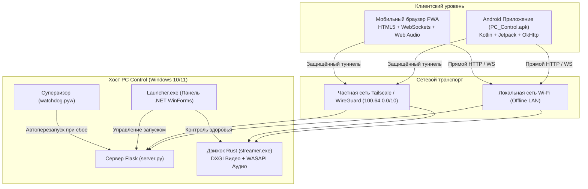

<div align="center">


# PC Control

**Быстрое, приватное и автономное управление компьютером на Windows со смартфона или браузера.**

[-0078D6?style=flat-square&logo=windows&logoColor=white)](https://microsoft.com/windows)
[](https://github.com/lavi-666/pc-control/actions/workflows/ci.yml)
[](https://github.com/lavi-666/pc-control/releases/latest)
[](tests/)
[](streamer_rs/)
[](runtime/)
[](LICENSE)

<br/>

<p align="center">
  <a href="https://github.com/lavi-666/pc-control/releases/latest/download/PC-Control-Setup.exe">
    
  </a>
  &nbsp;&nbsp;
  <a href="https://github.com/lavi-666/pc-control/releases/latest/download/PC_Control.apk">
    
  </a>
  &nbsp;&nbsp;
  <a href="https://github.com/lavi-666/pc-control/releases/latest/download/PC_Control_Windows.zip">
    
  </a>
</p>

<p align="center">
  <a href="README.md">English</a> &nbsp;•&nbsp; <b>Русский</b> &nbsp;•&nbsp; <a href="README.ru.old.md">Архив старой версии</a>
</p>

</div>

---

## ⚡ Почему PC Control?

Большинство систем удалённого доступа (TeamViewer, AnyDesk) требуют подключения к интернету, регистрации аккаунтов, прохождения через чужие облачные релеи и установки тяжёлых служб.

**PC Control устроен иначе:**
- 🔒 **100% локально и конфиденциально**: Работает напрямую внутри вашей сети Wi-Fi. Никаких аккаунтов, телеметрии и сторонних облачных серверов.
- ⚡ **Высокая производительность трансляции**: Аппаратный захват экрана через **DirectX DXGI** и ультранизкая задержка звука через **Windows WASAPI Loopback** на нативном движке Rust.
- 📱 **Две клиентские среды**: Компактное нативное приложение для Android (390 КБ) или мгновенное адаптивное веб-приложение (PWA) с подключением по QR-коду.
- 🎛️ **Глубокий контроль Windows**: Управление воспроизведением медиа (Spotify, YouTube, VLC), микшер громкости для отдельных запущенных приложений, мониторинг процессов, переключение раскладки клавиатуры и таймеры выключения.
- 💤 **Удалённое включение и питание**: Включение компьютера из состояния полного отключения по локальной сети через Wake-on-LAN (включая UDP-ретранслятор для сложных подсетей), сон, перезагрузка и таймер автоотключения.
- 📦 **Установка в один клик**: Единый инсталлятор `PC-Control-Setup.exe` со встроенной изолированной средой Python. Не нужно устанавливать Python, Rust, Git или другие инструменты разработки.

---

## 📊 Сравнение с аналогами

| Возможность | **PC Control** | RustDesk | TeamViewer / AnyDesk | Unified Remote |
| :--- | :---: | :---: | :---: | :---: |
| **Работа в локальной сети без интернета** | **Да** (100% автономно) | Через релей/LAN | Нет (Требует облако) | Да |
| **Без регистрации и создания аккаунтов** | **Да** (Вход по QR) | Да | Нет | Да |
| **Управление через браузер (без установки ПО)** | **Да** (Адаптивный PWA) | WebClient (Бета) | Через веб (с логином) | Нет |
| **Захват звука WASAPI в реальном времени** | **Да** (Rust-движок) | Стереопоток | Сжатый голосовой | Нет стриминга звука |
| **Микшер громкости отдельных приложений** | **Да** | Нет | Нет | Ограниченно |
| **Wake-on-LAN + ретранслятор для подсетей** | **Да** (Встроен) | Только базовый WoL | Сложная настройка | Только базовый WoL |
| **Единый автономный инсталлятор Windows** | **Да** (1.40 МБ) | Да | Да | Да |
| **Чистый деинсталлятор с откатом реестра** | **Да** (Журнал отката) | Стандартный | Оставляет следы | Стандартный |
| **Лицензия** | **MIT (Open Source)** | AGPL-3.0 | Проприетарная ($$$) | Проприетарная |

---

## 🚀 Быстрый старт за 60 секунд

### 📦 Выберите удобный способ установки

Программа распространяется в **трёх вариантах** — во всех случаях дальше всё делается в окне программы, без консоли, BAT-файлов и ручной правки JSON:

| Вариант | Файл | Кому подходит | Как запустить |
| :--- | :--- | :--- | :--- |
| **1. Установщик Windows** *(Рекомендуется)* | [`PC-Control-Setup.exe`](https://github.com/lavi-666/pc-control/releases/latest/download/PC-Control-Setup.exe) | Для большинства пользователей | Скачать, запустить мастер установки, выбрать папку и нажать «Установить». Создаст ярлыки на рабочем столе и в меню «Пуск», зарегистрирует программу в Windows. |
| **2. Портативная папка** *(Без установки)* | [`PC_Control_Windows.zip`](https://github.com/lavi-666/pc-control/releases/latest/download/PC_Control_Windows.zip) | Для запуска без установки / с флешки | Скачать ZIP-архив, распаковать в **любую папку** на компьютере и запустить `Launcher.exe`. Не вносит изменений в систему; для удаления достаточно удалить папку. |
| **3. Исходный код с GitHub** | Кнопка **Code → Download ZIP** на странице репозитория | Самая свежая версия | Распаковать в любую папку (путь может содержать пробелы и кириллицу) и запустить `Launcher.exe`. При первом запуске он сам скачает изолированный Python в папку `runtime\` (контрольная сумма проверяется) и установит библиотеки — нужен интернет, обычно 1–3 минуты. |

---

### Подключение смартфона

1. **Запустите `Launcher.exe`** (или ярлык PC Control). При первом запуске сам откроется **мастер настройки**, который по очереди проверяет и, если нужно, исправляет:
   - **Компоненты** — устанавливает недостающие библиотеки (ход установки виден в консоли панели);
   - **Сеть** — определяет IP-адрес ПК в локальной сети;
   - **Сервер** — запускает его; если порт 5000 занят другой программой или зарезервирован Windows, автоматически выбирает свободный и сохраняет его;
   - **Брандмауэр Windows** — объясняет, зачем нужно правило, и после вашего согласия создаёт его (Windows спросит подтверждение администратора); успех засчитывается, только если правило действительно появилось;
   - **Доступ из сети** — проверяет, что сервер отвечает по сетевому адресу.

   Если шаг не прошёл, мастер останавливается, показывает причину и кнопку **«Повторить»**. Открыть мастер повторно — кнопка **«Мастер настройки»** над чек-листом.
2. **Подключите телефон**:
   - **Вариант А (Веб-интерфейс)**: Отсканируйте QR-код камерой телефона — пульт откроется прямо в мобильном браузере (Safari, Chrome, Firefox).
   - **Вариант Б (Android APK)**: Установите [`PC_Control.apk`](https://github.com/lavi-666/pc-control/releases/latest/download/PC_Control.apk) на Android (8.0+) и отсканируйте QR-код через приложение.

🎉 **Компьютер полностью готов к удалённому управлению!**

---

## 🎯 Основные возможности

### 🖥️ Трансляция экрана и звука без задержек
- **Аппаратное ускорение**: Дублирование рабочего стола через DirectX DXGI с адаптивным масштабированием (720p, 1080p, 2K) и частотой 30 или 60 FPS.
- **Прямой захват звука**: Микростриминг системного аудио через WASAPI Loopback прямо в динамики телефона или наушники.
- **Минимальный пинг**: Быстрый сетевой транспорт на базе WebRTC и WebSocket, реализованный на Rust (`streamer.exe`).

### 🎵 Медиапульт и раздельный микшер громкости
- **Интеграция с Windows SMTC**: Название трека, исполнитель, обложка, статус воспроизведения (Play/Pause/Next/Prev) для Spotify, Яндекс Музыки, YouTube, Apple Music, VLC и браузеров.
- **Микшер приложений**: Регулировка громкости отдельных программ независимо от общей системы (например, приглушить фоновую музыку или браузер, не трогая звук игры).

### 🔌 Управление питанием и Wake-on-LAN
- **Wake-on-LAN**: Включение выключенного компьютера отправкой magic packet. Поддерживается межсетевой ретранслятор для изолированных подсетей и гостевых VLAN.
- **Сон, перезагрузка, выключение**: Быстрые действия в один тап с защитой от случайных нажатий.
- **Таймер сна**: Удобное выключение ПК через заданное время (например, через 40 минут при просмотре фильма перед сном) с возможностью отмены.

### 🛠️ Диспетчер задач и системные команды
- **Мониторинг процессов**: Список активных приложений с фильтрацией системных процессов.
- **Завершение зависших программ**: Безопасный принудительный kill по PID.
- **Смена языка ввода**: Мгновенное переключение активной раскладки Windows (RU/EN/UA).

---

## 🏗️ Архитектура системы



---

## 🔒 Модель безопасности

PC Control спроектирован с учётом нулевого доверия (Zero-Trust) внутри локальной сети:

- **Защита от Timing Attacks**: Проверка токенов авторизации выполняется через `secrets.compare_digest` с константным временем выполнения.
- **Адаптивный Rate Limiting и Lockout**: Защита от подбора паролей с временной блокировкой IP (15 попыток для локальной сети, 5 для внешних подключений).
- **Отсутствие облачных зависимостей**: Пароли и токены хранятся исключительно на локальном компьютере. Никакие данные не передаются наружу.
- **Изолированный тестовый режим**: Режим тестирования активируется строго системными переменными окружения ОС и не может быть включен клиентом через HTTP-заголовки.
- **Защита от Path Traversal**: Все файловые маршруты проверяют выход за пределы корневой директории (`..` и null-байты блокируются).

---

## 📦 Автономный установщик (PC-Control-Setup.exe)

Для максимального удобства распространения PC Control поставляется в виде одного независимого исполняемого файла [`PC-Control-Setup.exe`](PC-Control-Setup.exe) (1.40 МБ):

- **Как устроен**: Написан на C# ([`scripts/Installer.cs`](scripts/Installer.cs)) с использованием Windows Forms и компилируется стандартным компилятором Windows `csc.exe` без внешних зависимостей через утилиту сборки [`scripts/build_installer.py`](scripts/build_installer.py).
- **Встроенная полезная нагрузка**: Все файлы приложения (сервер, веб-интерфейс, Rust-стример, среда выполнения и деинсталлятор `Uninstall.exe`) сжаты и встроены прямо в бинарник установщика в виде сжатого ресурса `DeflateStream`.
- **Графический интерфейс**: Тёмная тема в едином стиле приложения, выбор папки установки (по умолчанию `%LocalAppData%\Programs\PC Control`), флажки создания ярлыков на рабочем столе и в меню «Пуск», шкала реального прогресса распаковки.
- **Тихая автоматическая установка (CLI)**:
  ```powershell
  # Тихая установка без окон и диалогов:
  .\PC-Control-Setup.exe /SILENT /DIR="C:\Games\PC Control" /NORUN
  ```
- **Регистрация в Windows**: Создаёт корректную запись в системном реестре `HKCU\Software\Microsoft\Windows\CurrentVersion\Uninstall\PC Control` с возможностью быстрого вызова деинсталлятора из стандартного списка «Параметры» $\rightarrow$ «Установленные приложения».
- **Скрипт Inno Setup**: Проект также включает готовый конфигурационный файл [`scripts/installer.iss`](scripts/installer.iss) для альтернативной сборки инсталлятора через Inno Setup на CI-серверах.

---

## 🧹 Чистый деинсталлятор (Uninstall.exe)

В комплект поставки входит автономный деинсталлятор (`Uninstall.exe`), обеспечивающий полное удаление приложения без остаточного мусора в системе:

- **Безопасность процессов**: Останавливает только те процессы, которые были запущены из директории PC Control.
- **Откат реестра и брандмауэра**: Удаляет записи из `Add/Remove Programs` реестра Windows и собственные правила брандмауэра.
- **Журнал отката**: Анализирует `system_state_journal.json` и возвращает изменённые системные настройки в исходное состояние.
- **Политика конфликтов**: Поддерживает флаг `--conflict-policy keep|restore` для корректного разрешения сторонних изменений.
- **Самоудаление**: Очищает каталоги `%LOCALAPPDATA%\Programs\PC Control`, `%LOCALAPPDATA%\PCControl` и удаляет собственный исполняемый файл.

```powershell
# Интерактивный запуск мастера удаления:
.\Uninstall.exe

# Тихая фоновая деинсталляция:
.\Uninstall.exe --silent --conflict-policy restore
```

---

## 🧪 Тестирование и гарантия надёжности

Перед каждым релизом проводится сквозная автоматизированная проверка:

- **Тесты установщика и деинсталлятора**:
  - [`tests/test_installer.py`](tests/test_installer.py): Автоматическая проверка тихой установки `PC-Control-Setup.exe`, распаковки всех файлов, регистрации в реестре Windows в путях с пробелами и кириллицей, а также последующего удаления.
  - [`tests/test_uninstall_and_lifecycle.py`](tests/test_uninstall_and_lifecycle.py): 7 изолированных сценариев деинсталлятора в песочнице (нетронутые настройки, откат, конфликтные политики, повреждённый журнал, идемпотентность, безопасность процессов).
- **Комплексный 650-цикловый сьют**: Охватывает 26 тематических пакетов тестов:
  ```powershell
  python tests/run_all_650_tests.py
  # Результат: ALL 650/650 CYCLES PASSED (100% УСПЕХ)
  ```
- **98 модульных и интеграционных тестов**:
  ```powershell
  python -m unittest discover -s tests -p "test_*.py"
  # Результат: Ran 98 tests in 52.5s OK
  ```

---

<details>
<summary><b>⚙️ Справочник конфигурации (config.json)</b> (Нажмите, чтобы развернуть)</summary>

<br/>

Файл конфигурации `config.json` генерируется автоматически при первом запуске:

```json
{
  "auto_network": true,
  "token": "6d1a91811a8d1dc3",
  "lan_ip": "192.168.1.100",
  "vpn_ip": "100.90.144.13",
  "wol_relay_ip": "",
  "mac_address": "D8-43-AE-18-30-25",
  "port": 5000,
  "relay_port": 5050,
  "language": "ru",
  "cors_allowed_origins": [
    "http://localhost:*",
    "http://127.0.0.1:*",
    "http://192.168.*",
    "http://100.*"
  ]
}
```

| Параметр | Тип | По умолчанию | Описание |
| :--- | :---: | :---: | :--- |
| `token` | string | Автоматически | 16-значный hex-токен доступа (передаётся в `X-Auth-Token` или cookie). |
| `port` | integer | `5000` | Порт веб-интерфейса и REST API сервера. |
| `relay_port` | integer | `5050` | Порт службы ретрансляции Wake-on-LAN для подсетей. |
| `auto_network` | boolean | `true` | Автоопределение локального Wi-Fi и Tailscale IP-адресов при старте. |
| `language` | string | `"ru"` | Язык интерфейса по умолчанию (`"ru"`, `"en"`, `"uk"`). |
| `cors_allowed_origins` | list | `["..."]` | Разрешённые источники CORS для безопасности браузера. |

</details>

---

<details>
<summary><b>🌐 Справочник маршрутов REST API</b> (Нажмите, чтобы развернуть)</summary>

<br/>

Для всех запросов (кроме публичных `/status` и `/login`) требуется заголовок `X-Auth-Token` или cookie `pc_token`.

| Метод | Маршрут | Описание |
| :--- | :--- | :--- |
| `GET` | `/status` | Состояние сервера, имя хоста и идентификатор инстанса. |
| `GET` / `POST` | `/volume` | Чтение мастер-громкости или установка уровня (`{"percent": 50}`). |
| `GET` / `POST` | `/volume/apps` | Список аудиосессий приложений или установка громкости для конкретного процесса. |
| `GET` / `POST` | `/media` | Получение информации о текущем треке или управление воспроизведением. |
| `GET` | `/screen/monitors` | Список доступных дисплеев и их разрешение. |
| `POST` | `/screen/config` | Настройка параметров стриминга (`height`, `fps`). |
| `GET` / `POST` | `/processes` | Список процессов или завершение процесса по PID (`/processes/kill`). |
| `POST` | `/power/sleep` | Перевод компьютера в спящий режим. |
| `POST` | `/power/reboot` | Перезагрузка компьютера. |
| `POST` | `/power/shutdown` | Полное выключение компьютера. |
| `POST` | `/power/timer` | Установка таймера выключения через $N$ минут. |
| `POST` | `/wake` | Отправка magic packet Wake-on-LAN на указанный MAC-адрес. |

</details>

---

<details>
<summary><b>🛠️ Сборка из исходного кода</b> (Нажмите, чтобы развернуть)</summary>

<br/>

### Требования к окружению
- Windows 10 или 11 (x64)
- Python 3.12+ (или встроенная среда `runtime/`)
- Microsoft .NET Framework 4.5+ (входит в состав Windows)
- *(Опционально)* Rust & Cargo (для сборки `streamer_rs`)
- *(Опционально)* Android SDK & JDK 17 (для пересборки `PC_Control.apk`)

### Команды сборки компонентов
```powershell
# 1. Компиляция Launcher.exe:
csc /target:winexe /out:Launcher.exe /win32icon:pc_control.ico /r:System.Windows.Forms.dll,System.Drawing.dll scripts/Launcher.cs

# 2. Компиляция Uninstall.exe:
csc /target:winexe /out:Uninstall.exe /win32icon:pc_control.ico /r:System.Windows.Forms.dll,System.Drawing.dll scripts/Uninstall.cs

# 3. Сборка единого инсталлятора PC-Control-Setup.exe:
python scripts/build_installer.py

# 4. Сборка Android-приложения PC_Control.apk:
python scripts/build_apk.py

# 5. Сборка Rust-стримера (tools/streamer.exe):
cd streamer_rs
cargo build --release
Copy-Item target/release/streamer_rs.exe ../tools/streamer.exe
```

</details>

---

## ❓ Часто задаваемые вопросы

<details>
<summary><b>Можно ли управлять компьютером вне домашней сети (удалённо)?</b></summary>
Да! Достаточно установить бесплатный <a href="https://tailscale.com">Tailscale</a> на компьютер и смартфон. PC Control автоматически обнаружит виртуальный IP-адрес <code>100.64.0.0/10</code> и сделает панель доступной через защищённый WireGuard-туннель без проброса портов на роутере.
</details>

<details>
<summary><b>Телефон не может подключиться к серверу. Что делать?</b></summary>
1. Убедитесь, что телефон и компьютер подключены к одному роутеру Wi-Fi.<br/>
2. Проверьте в настройках роутера, что не включена функция "Изоляция клиентов" (AP Isolation / Client Isolation).<br/>
3. Запустите **«Мастер настройки»** в панели — он проверит сервер, брандмауэр и доступ по сети и покажет, на каком шаге проблема. Номер порта показан в шапке панели («Сервер онлайн (порт …)»).<br/>
4. Отключите VPN на ПК (кроме Tailscale) и проверьте, не блокирует ли подключения сторонний антивирус/брандмауэр.
</details>

<details>
<summary><b>Передаются ли мои данные на внешние серверы?</b></summary>
Нет. В PC Control полностью отсутствуют аналитика, телеметрия и сбор данных. Вся работа происходит исключительно напрямую между вашим телефоном и компьютером.
</details>

---

## 📄 Лицензия

Проект распространяется под свободной лицензией [MIT](LICENSE).  
Вопросы, предложения и отчёты об ошибках принимаются в [GitHub Issues](https://github.com/lavi-666/pc-control/issues).
