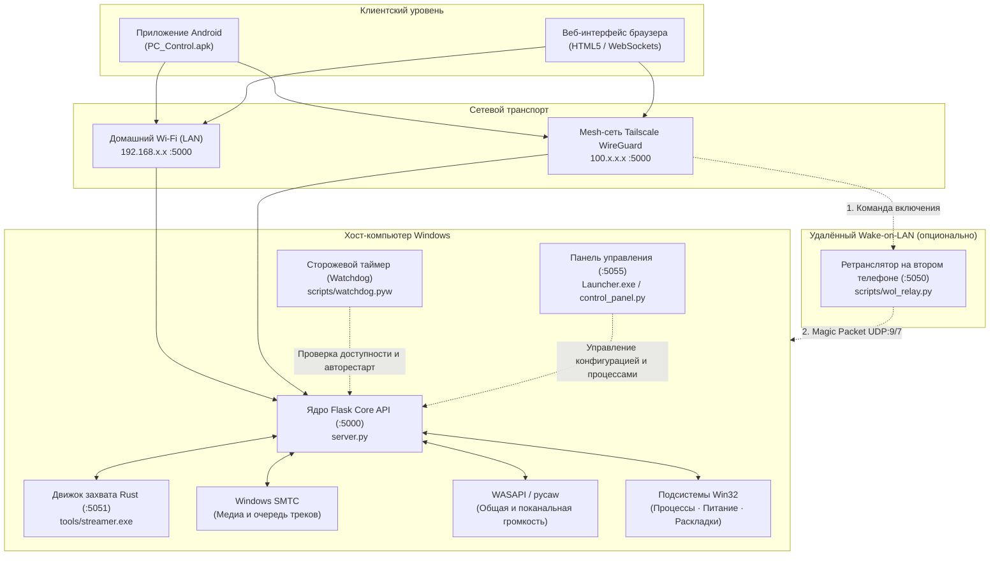

<div align="center">

<p align="center">
  <b>Русский</b> &nbsp;|&nbsp; <a href="README.md">English</a>
</p>

# PC Control

**Автономный Windows-сервис и клиентская экосистема для дистанционного администрирования ПК, управления мультимедиа, аудио/видео-трансляции (WASAPI/DXGI) и Wake-on-LAN с Android и Web.**

[-0078D6?style=flat-square&logo=windows&logoColor=white)](https://microsoft.com/windows)
[](https://github.com/lavi-666/pc-control/actions/workflows/ci.yml)
[](https://github.com/lavi-666/pc-control/releases/latest)
[](https://www.python.org/)
[](https://www.rust-lang.org/)
[](https://github.com/lavi-666/pc-control/releases/latest/download/PC_Control.apk)
[](https://tailscale.com)
[](LICENSE)

<br/>

<p align="center">
  <a href="https://github.com/lavi-666/pc-control/releases/latest/download/PC_Control_Windows.zip">
    
  </a>
  &nbsp;&nbsp;
  <a href="https://github.com/lavi-666/pc-control/releases/latest/download/PC_Control.apk">
    
  </a>
  &nbsp;&nbsp;
  <a href="https://github.com/lavi-666/pc-control/releases/latest/download/Launcher.exe">
    
  </a>
</p>

<p align="center">
  <sub>Официальные готовые сборки и SHA-256 контрольные суммы публикуются в <a href="https://github.com/lavi-666/pc-control/releases/latest"><b>GitHub Releases</b></a>.</sub>
</p>

</div>

---

## Содержание

- [О проекте](#о-проекте)
- [Архитектура](#архитектура)
- [Функциональные возможности](#функциональные-возможности)
- [Системные требования](#системные-требования)
- [Быстрый запуск и первичная настройка](#быстрый-запуск-и-первичная-настройка)
- [Запуск и управление сервером](#запуск-и-управление-сервером)
- [Клиентские приложения](#клиентские-приложения)
- [Удалённый доступ и Wake-on-LAN](#удалённый-доступ-и-wake-on-lan)
- [Справочник конфигурации (config.json)](#справочник-конфигурации-configjson)
- [Справочник REST API](#справочник-rest-api)
- [Модель безопасности](#модель-безопасности)
- [Тестирование и контроль качества](#тестирование-и-контроль-качества)
- [Устранение неисправностей](#устранение-неисправностей)
- [Лицензия](#лицензия)

---

## О проекте

PC Control предоставляет защищённую систему дистанционного управления компьютерами под управлением Windows. Проект позволяет управлять воспроизведением медиафайлов, регулировать общую и индивидуальную громкость запущенных программ, отслеживать процессы, управлять питанием и транслировать рабочий стол вместе со звуком напрямую на смартфон или через веб-интерфейс.

Система спроектирована для работы в двух сетевых режимах:
1. **Локальная сеть (LAN)**: Работает полностью автономно в домашней сети Wi-Fi без подключения к интернету и сторонних облачных сервисов.
2. **Шифрованная сеть WireGuard (Tailscale)**: Предоставляет доступ из любой точки мира через частную подсеть `100.64.0.0/10` без проброса портов на роутере и выделенного белого IP-адреса.

Серверная часть состоит из ядра на Python/Flask, высокопроизводительного микросервиса захвата на Rust (`tools/streamer.exe`) для аппаратного дублирования экрана через DXGI и захвата звука через WASAPI Loopback, а также фонового супервизора (`scripts/watchdog.pyw`), обеспечивающего автоматическое восстановление при сбоях.

---

## Архитектура



### Спецификация компонентов

| Компонент | Технологический стек | Порт по умолчанию | Назначение |
|:---|:---|:---|:---|
| **Core API Server** | Python 3 / Flask | `TCP 5000` | Маршрутизация REST API, проверка авторизационного токена, защита от подбора пароля (`server.py`). |
| **Streaming Microservice** | Rust / DXGI / WASAPI | `TCP 5051` | Аппаратный захват экрана через DXGI, loopback-захват аудио и WebRTC-трансляция (`tools/streamer.exe`). |
| **Watchdog Supervisor** | Python (`watchdog.pyw`) | Н/Д | Фоновый сторожевой процесс, предотвращение циклических перезапусков, автовосстановление. |
| **Панель управления (Launcher)** | C# / Python HTTP server | `TCP 5055` | Локальный графический интерфейс для проверки окружения, управления службой и сетевыми параметрами (`Launcher.exe`). |
| **Клиент Android** | Java / WebView / OkHttp | Динамический | Автономное мобильное приложение с поддержкой фонового воспроизведения звука (`PC_Control.apk`). |
| **Веб-клиент** | HTML5 / JavaScript | `TCP 5000` | Браузерный интерфейс управления, раздаваемый напрямую сервером. |
| **Служба WOL Relay** | Python (`wol_relay.py`) | `TCP 5050` | Сервис для включения выключенного ПК из внешней сети через второй домашний девайс. |

### Структура репозитория

```text
pc-control/
├── server.py              # Точка входа Flask и регистрация Blueprint-модулей
├── core/                  # Базовая инфраструктура (аутентификация, лимиты, конфиг)
│   ├── auth.py            # Двухуровневая аутентификация и защита от брутфорса
│   ├── config.py          # Управление конфигурацией с валидацией схемы
│   └── logger.py          # Структурированный аудит действий и лог ошибок
├── modules/               # Модульные Blueprint-контроллеры
│   ├── media.py           # SMTC-контроллер и диспетчер эндпоинтов воспроизведения
│   ├── media_api.py       # Парсинг очереди и треков YouTube Music
│   ├── media_history.py   # Потокобезопасная история прослушивания
│   ├── media_keys.py      # Win32-эмуляция медиа-клавиш и переключение окон
│   ├── media_queue.py     # Состояние живой очереди, синхронизация и автомикс
│   ├── media_uia.py       # UI Automation для вкладок браузера и DOM-элементов
│   ├── media_volume.py    # WASAPI-регулировка громкости сессии медиаплеера
│   ├── power.py           # Выключение, перезагрузка, сон и блокировка ПК
│   ├── presets.py         # Настраиваемые сценарии запуска с нечетким поиском программ
│   ├── streaming.py       # Прокси трансляции экрана и WASAPI-аудио в WebRTC
│   ├── system.py          # Диспетчер задач, завершение процессов, раскладки клавиатуры
│   └── volume.py          # Мастер-громкость и поканальный WASAPI-микшер
├── web/                   # Ресурсы веб-интерфейса и шаблоны панелей
│   ├── index.html         # Семантическая разметка веб-клиента (90 КБ)
│   ├── css/styles.css     # Стили и адаптивная верстка (44 КБ)
│   ├── js/                # Модульная архитектура клиентского скрипта
│   │   ├── i18n.js        # Мультиязычные словари локализации (uk, ru, en)
│   │   ├── stream.js      # Контроллеры WebRTC аудио- и видеотрансляции
│   │   ├── media.js       # Таймлайн плеера, живая очередь и история треков
│   │   ├── presets.js     # Редактор сценариев запуска и движок выполнения
│   │   └── app.js         # Роутер подключения, выбор сети и системный интерфейс
│   └── control_panel.html # Разметка панели управления Launcher (:5055, 158 КБ)
├── scripts/               # Утилиты сборки и фоновые службы
│   ├── build_apk.py       # Автосборка APK с динамической подстановкой ассетов
│   ├── control_panel.py   # Сервер панели управления Launcher (:5055, 100 КБ)
│   └── watchdog.pyw       # Фоновый сторожевой процесс (Watchdog)
├── android_app/           # Исходный код Android-приложения (WebView-обёртка)
└── tests/                 # Полный регрессионный тестовый набор (650 тестов)
```

---

## Функциональные возможности

### 1. Управление медиаплеером и живой очередью (Windows SMTC)
- Интеграция с системным транспортом мультимедиа Windows (`Windows.Media` через WinSDK).
- Двусторонняя синхронизация с проигрывателями: YouTube Music, Spotify, десктопными плеерами и медиавкладками браузеров.
- Считывание метаданных трека: название, исполнитель, обложка альбома, длительность и прогресс воспроизведения.
- Навигация по живой очереди: просмотр списка треков активного плейлиста и переключение между ними.
- Сохранение истории прослушивания в `listening_history.json`.

### 2. Управление звуком и микшер приложений
- Регулировка мастер-громкости системы и переключение режима без звука (Mute) через Windows Core Audio (WASAPI).
- Поканальный микшер приложений: опрос активных аудиосессий (игры, браузеры, голосовые чаты) с раздельной регулировкой громкости и отключением звука для каждого процесса.
- Потокобезопасная инициализация COM-интерфейсов и кэширование параметров громкости для исключения задержек интерфейса.

### 3. Трансляция рабочего стола и системного звука
- Аппаратный захват экрана с помощью нативного микросервиса на Rust (`tools/streamer.exe`), использующего DirectX Graphics Infrastructure (DXGI) Desktop Duplication API.
- Определение конфигурации нескольких мониторов и переключение между ними на лету.
- Передача звука системы через WASAPI Loopback по протоколу WebRTC (кодек Opus, 48 кГц stereo).
- Поддержка фонового воспроизведения звука на Android (трансляция аудио продолжается при заблокированном экране смартфона).

### 4. Управление процессами и администрирование
- Монитор активных задач в реальном времени с отображением PID, имени исполняемого файла и потребления оперативной памяти.
- Принудительное завершение зависших процессов в один клик (`taskkill`).
- Переключение языка ввода: запрос списка установленных раскладок Windows и циклическое переключение (`WM_INPUTLANGCHANGEREQUEST` / Win32 HKL).
- Журнал аудита действий с последовательной записью в `actions_log.jsonl`.

### 5. Управление питанием и Wake-on-LAN
- Команды питания: завершение работы, перезагрузка, перевод в спящий режим (ACPI S3) и блокировка экрана (`Win+L`).
- Таймер выключения с возможностью отмены в любой момент.
- Локальный Wake-on-LAN: отправка UDP Magic Packet (порты 7 и 9) по широковещательным адресам подсети.
- Удалённый Wake-on-LAN: пересылка сигнала пробуждения через домашний ретранслятор (`scripts/wol_relay.py`).

### 6. Сценарии запуска (Launch Presets)
- Настраиваемые цепочки автоматизации, хранящиеся в файле `launch_presets.json`.
- Поддерживаемые шаги: запуск программ (с автоматическим обнаружением установленного ПО), открытие ссылок в браузере и настраиваемые паузы между шагами.
- Асинхронное выполнение цепочки с индикацией текущего шага и возможностью экстренной остановки.

### 7. Надежность и сторожевой процесс (Watchdog)
- Независимый фоновый супервизор (`scripts/watchdog.pyw`) опрашивает работоспособность сервера каждые 30 секунд.
- Защита от запуска дубликатов через системный мьютекс (`Local\PCControlWatchdogMutex`).
- Автоматический перезапуск сервера при фиксации двух последовательных неудачных проверок.
- Защита от бесконечного цикла падений: не более 5 перезапусков в течение 150 секунд.
- Корректная обработка штатной остановки через сигнальный файл `manual_stop.flag`.

---

## Системные требования

### Хост-компьютер (Windows)
- **Операционная система**: Windows 10 (версия 1809 или новее) или Windows 11 (64-бит).
- **Python**: встроен в полный Windows ZIP вместе с библиотеками; установка Python и pip пользователем не нужна. Архив исходников автоматически скачивает частную среду при первом запуске (нужен интернет).
- **Сетевая карта**: Для поддержки Wake-on-LAN рекомендуется проводное подключение через Ethernet.

### Клиентские устройства
- **Android**: Android 8.0 (API level 26) или новее.
- **Веб-браузер**: Любой современный браузер с поддержкой HTML5, WebSockets и WebRTC (Chrome, Edge, Firefox, Safari).

---

## Быстрый запуск и первичная настройка

Проект полностью автоматизирован «из коробки». Пользователю не требуется вручную настраивать виртуальные окружения, запускать консольные команды pip или редактировать конфигурационные файлы.

### 1. Скачайте проект
Скачайте **PC_Control_Windows.zip** из Releases и распакуйте папку `PC_Control` целиком в доступное для записи место. Архив содержит Python и библиотеки в `runtime`: первая подготовка не требует скачивания зависимостей. Не переносите `Launcher.exe` отдельно от остальных файлов. Вариант GitHub «Code → Download ZIP» также поддерживается: лаунчер скачает проверенный Python и библиотеки автоматически, показывая ход подготовки. Для него при первом запуске необходим интернет.

Скачайте репозиторий в виде ZIP-архива с GitHub и распакуйте в удобную папку, либо клонируйте через git:
```cmd
git clone https://github.com/lavi-666/pc-control.git
cd pc-control
```

### 2. Запустите Launcher.exe
Дважды щелкните по `Launcher.exe` (или запустите `launcher.bat`):
```cmd
Launcher.exe
```

При первом запуске **Launcher.exe автоматически выполняет всю подготовку**:
1. **Среда выполнения**: использует встроенный Python из `runtime`, независимо от Python и виртуальных окружений в Windows. Если среды нет, скачивает её автоматически без прав администратора.
2. **Конфигурация**: создаёт `config.json`, определяет сетевые адреса и генерирует случайный пароль. Адреса, порт, пароль и CORS можно изменить через интерфейс.
3. **Проверка библиотек**: проверяет импорты в том же интерпретаторе, который запускает сервер. При ошибке доступны журнал и восстановление зависимостей.
4. **Запуск**: проверьте настройки и нажмите «Запустить». Успех подтверждается HTTP-ответом своего сервера; затем доступен перезапуск и остановка.

> [!IMPORTANT]
> **Отсутствие небезопасных паролей по умолчанию**: Проект не использует дефолтные статические пароли. При первичной инициализации система генерирует надежный случайный токен доступа, сохраняя его в `config.json`. Посмотреть, скопировать или сменить пароль можно в любой момент прямо в интерфейсе Launcher или с помощью утилиты `change_password.exe`.

Панель управления отобразит адреса для подключения, статус сервера и QR-код для мобильного клиента.

### 3. Подключите клиентские устройства
- **Веб-интерфейс**: Откройте отображаемый адрес (`http://<IP_ПК>:5000/`) в браузере телефона или планшета и авторизуйтесь.
- **Мобильное приложение Android**: Установите готовый файл `PC_Control.apk` (находится в корне репозитория) на ваш смартфон.

---

### Дополнительная и расширенная настройка

Все параметры можно изменять прямо в графическом интерфейсе Launcher. Для серверов без графической оболочки или продвинутого администрирования также доступны консольные инструменты:

#### Брандмауэр Windows Defender (Рекомендуется для доступа по сети)
Чтобы разрешить входящие подключения клиентов из домашней сети и Tailscale с защитой от внешнего интернета, нажмите кнопку **Настроить** у Шага 4 в чек-листе панели, либо выполните:
```cmd
scripts\apply_firewall_rule.bat
```
Скрипт запросит права Администратора (UAC) и создаст правило для порта 5000 с ограничением подсетями `LocalSubnet` и диапазоном Tailscale (`100.64.0.0/10`).

#### Смена пароля и консольный мастер настройки
Изменить пароль доступа можно прямо в окне Launcher по кнопке **Изменить**. Также доступен интерактивный консольный мастер:
```cmd
scripts\configure.bat
```

#### Ручная установка библиотек (CLI)
Для работы в выделенном виртуальном окружении без графического интерфейса:
```cmd
python -m pip install --upgrade pip
pip install -r requirements.txt
```

---

## Запуск и управление сервером

### Способ 1: Графическая панель управления (Launcher)
Запустите графическое приложение:
```cmd
Launcher.exe
```
*(Или выполните `launcher.bat`)*

Панель запускает локальный сервис на `http://127.0.0.1:5055` и открывает окно управления. В панели отображаются сетевые адреса, статус сервера, активные клиенты Tailscale, а также доступны кнопки быстрого запуска/остановки, живой терминал логов и параметры автовхода Windows.

Ключевые возможности Launcher:
- **Автоматическая проверка обновлений**: При запуске приложение опрашивает GitHub API. Если доступен свежий релиз, отображается ненавязчивый информационный баннер: *«Доступна новая версия PC Control»* с кнопкой **Обновить сейчас** и кнопкой закрытия **✕**.
- **Ручная проверка**: Нажатие кнопки *«Проверить обновления»* проверяет наличие свежей версии и сообщает: *«У вас установлена последняя версия»*, если обновление не требуется.
- **Безопасное фоновое обновление**: При нажатии **Обновить сейчас** файл загружается напрямую с официального репозитория GitHub по HTTPS, проверяется валидность заголовков PE (`MZ` и `PE\0\0`), после чего запускается фоновый скрипт `scripts/updater.bat`. Скрипт ожидает завершения лаунчера, безопасно заменяет исполняемый файл и перезапускает панель.
- **Очистка профилей и кэша браузеров**: Встроенная функция обслуживания для удаления временных профилей и кэша веб-компонентов.
- **Ротация токена**: Безопасная генерация нового случайного токена в один клик без остановки сервера.

### Способ 2: Фоновый запуск службы
Для скрытой работы без отображения консольных окон:
- **Запуск**: Запустите `start_server.bat` (или `scripts\3_start_server.bat`). Будут запущены `server.py` и сторожевой процесс `scripts\watchdog.pyw`.
- **Остановка**: Запустите `stop_server.bat`. Корректно завершит процессы `server.py`, `watchdog.pyw` и `tools\streamer.exe`.
- **Запуск в терминале (для отладки)**:
  ```cmd
  python server.py
  ```

---

## Клиентские приложения

### Веб-интерфейс
Откройте браузер на смартфоне, планшете или другом компьютере в той же сети (или в сети Tailscale) и перейдите по адресу:
```text
http://<IP_КОМПЬЮТЕРА>:5000/
```
Введите токен авторизации, настроенный в `config.json`.

### Приложение для Android
1. Установите `PC_Control.apk` на Android-устройство (файл находится в корне репозитория).
2. Запустите приложение и укажите адрес сервера (`http://192.168.x.x:5000` или `http://100.x.x.x:5000`) и токен доступа.
3. Для сборки персонального APK со встроенными сетевыми параметрами выполните:
   ```cmd
   python scripts/build_apk.py
   ```
   Скрипт задействует встроенный автономный инструментарий Android SDK из каталога `.android_sdk` (aapt2, d8, zipalign, apksigner) и сформирует подписанный пакет без необходимости установки Android Studio.

---

## Удалённый доступ и Wake-on-LAN

### Удалённый доступ через Tailscale
Для управления компьютером вне дома без настройки роутера и проброса портов:
1. Установите [Tailscale](https://tailscale.com) на компьютер (используя дистрибутив `tailscale-setup-1.102.4.exe` или сайт разработчика).
2. Установите приложение Tailscale на смартфон из Google Play или App Store.
3. Авторизуйтесь под одной и той же учётной записью на обоих устройствах.
4. В клиенте укажите выданный компьютеру виртуальный адрес Tailscale (`100.x.x.x`). Трафик передается внутри сквозного шифрованного туннеля WireGuard.

### Настройка включения по сети (Wake-on-LAN)

#### 1. Параметры BIOS/UEFI материнской платы
Включите дежурное питание сетевого адаптера:
- Переведите **Wake on LAN**, **Resume by Onboard LAN** или **Resume by PCI-E Device** в значение **Enabled**.
- Переведите **ErP Ready** / **Deep Sleep** в значение **Disabled** (активный режим ErP полностью обесточивает сетевой порт при выключении ПК).

#### 2. Конфигурация сетевой карты и автовхода в Windows
Запустите скрипт настройки от имени Администратора:
```cmd
scripts\2_setup_autologon.cmd
```
Скрипт автоматически:
- Активирует параметры обработки Magic Packet в драйвере сетевой карты (`*WakeOnMagicPacket = 1`).
- Отключает быстрый запуск Windows (`HiberbootEnabled = 0`), который часто препятствует приему пакета включения.
- Добавляет ярлык запуска сервера в автозагрузку Windows.
- Устанавливает параметр реестра `DevicePasswordLessBuildVersion = 0` и открывает системную утилиту `netplwiz`.

> [!IMPORTANT]
> При настройке автоматического входа в окне `netplwiz` обязательно вводите **пароль вашей учетной записи Microsoft/Windows**, а не короткий PIN-код Windows Hello. Указание PIN-кода приведет к ошибке авторизации при загрузке.

#### 3. Ретранслятор включения вне дома (WOL Relay)
Выключенный компьютер не поддерживает активное VPN-соединение. Для его удаленного включения через интернет:
1. Запустите скрипт `scripts/wol_relay.py` на дополнительном устройстве, постоянно находящемся в домашней сети Wi-Fi (например, на старом смартфоне с Termux или одноплатном ПК):
   ```bash
   python scripts/wol_relay.py
   ```
2. Ретранслятор ожидает команды на порту `5050`. В настройках клиента укажите его адрес Tailscale (например, `http://100.64.0.2:5050`).
3. При нажатии кнопки включения команда поступит на ретранслятор, который сформирует и разошлет Magic Packet по локальной сети Ethernet.

---

## Справочник конфигурации (config.json)

Параметры сохраняются в файле `config.json` в корневой директории проекта:

```json
{
  "token": "ваш_секретный_пароль",
  "lan_ip": "192.168.0.100",
  "vpn_ip": "100.64.0.1",
  "wol_relay_ip": "100.64.0.2",
  "mac_address": "AA-BB-CC-DD-EE-FF",
  "port": 5000,
  "relay_port": 5050,
  "language": "ru",
  "cors_allowed_origins": [
    "http://localhost:*",
    "http://127.0.0.1:*",
    "http://192.168.*",
    "http://100.*",
    "http://10.*"
  ]
}
```

| Параметр | Тип | По умолчанию | Описание |
|:---|:---|:---|:---|
| `token` | `string` | *(генерируется)* | Секретный пароль авторизации. Генерируется криптографически при первом запуске (`secrets.token_hex`). Статический пароль по умолчанию отсутствует. Передаётся в заголовке `X-Auth-Token`, cookie или на форме `/api/auth/login`. |
| `lan_ip` | `string` | `"192.168.0.101"` | Локальный IPv4-адрес компьютера в домашней сети. |
| `vpn_ip` | `string` | `""` | Виртуальный IPv4-адрес компьютера в сети Tailscale. |
| `wol_relay_ip` | `string` | `""` | IPv4-адрес телефона-ретранслятора для Wake-on-LAN вне дома. |
| `mac_address` | `string` | `"AA-BB-CC-DD-EE-FF"` | Физический MAC-адрес сетевой карты для формирования Magic Packet. |
| `port` | `integer` | `5000` | TCP-порт основного сервера Flask и веб-клиента. |
| `relay_port` | `integer` | `5050` | TCP-порт службы ретрансляции Wake-on-LAN (`wol_relay.py`). |
| `language` | `string` | `"ru"` | Код языка интерфейса (`"en"`, `"ru"`, `"uk"`). |
| `cors_allowed_origins` | `array` | `["http://localhost:*", ...]` | Белый список разрешённых HTTP Origin заголовков CORS. Поддерживает маски подсетей для доверенных локальных сетей и Tailscale. |

Для быстрой смены пароля доступа в любое время запустите:
```cmd
change_password.exe
```
*(Или выполните `change_password.bat`)*

---

## Справочник REST API

Все запросы, изменяющие состояние системы, требуют авторизации через заголовок `X-Auth-Token` или параметр `token` в теле запроса.

### Системный статус и мониторинг

| Метод | Эндпоинт | Описание |
|:---|:---|:---|
| `GET` | `/status` | Возвращает телеметрию компьютера, нагрузку CPU/RAM, уровень громкости, плеер и время работы. |
| `GET` | `/health` | Легковесная проверка доступности сервиса для сторожевого таймера. |
| `GET` | `/actions/log` | Возвращает список последних действий из журнала аудита. |

### Управление громкостью и микшер

| Метод | Эндпоинт | Пример полезной нагрузки | Описание |
|:---|:---|:---|:---|
| `GET` | `/volume` | Н/Д | Возвращает процент общей системной громкости и флаг Mute. |
| `POST` | `/volume` | `{"percent": 45}` | Устанавливает общую системную громкость (0–100). |
| `GET` | `/app_volumes` | Н/Д | Возвращает список активных аудиосессий запущенных приложений. |
| `POST` | `/app_volume` | `{"pid": 4820, "percent": 70}` | Регулирует громкость конкретного приложения по PID. |
| `POST` | `/app_volume/mute` | `{"pid": 4820, "mute": true}` | Включает или выключает звук для процесса. |

### Медиаплеер (SMTC)

| Метод | Эндпоинт | Пример полезной нагрузки | Описание |
|:---|:---|:---|:---|
| `GET` | `/media/status` | Н/Д | Возвращает статус плеера, метаданные трека и ссылку на обложку. |
| `POST` | `/media/play_pause` | Н/Д | Переключает режим воспроизведения/паузы. |
| `POST` | `/media/next` | Н/Д | Переходит к следующему треку. |
| `POST` | `/media/prev` | Н/Д | Переходит к предыдущему треку. |
| `GET` | `/media/queue` | Н/Д | Возвращает текущую очередь воспроизведения активного плеера. |
| `POST` | `/media/play_index` | `{"index": 3}` | Запускает воспроизведение трека по индексу из очереди. |
| `GET` | `/media/history` | Н/Д | Возвращает локальную историю прослушивания. |

### Процессы и системные переключатели

| Метод | Эндпоинт | Пример полезной нагрузки | Описание |
|:---|:---|:---|:---|
| `GET` | `/processes` | Н/Д | Возвращает список пользовательских процессов, отсортированных по памяти. |
| `POST` | `/process/kill` | `{"pid": 10240}` | Принудительно завершает процесс по PID. |
| `GET` | `/keyboard/layout` | Н/Д | Возвращает активную и установленные раскладки клавиатуры. |
| `POST` | `/keyboard/toggle` | Н/Д | Переключает раскладку ввода на следующую по списку. |

### Управление питанием

| Метод | Эндпоинт | Пример полезной нагрузки | Описание |
|:---|:---|:---|:---|
| `POST` | `/power/shutdown` | Н/Д | Немедленно завершает работу компьютера. |
| `POST` | `/power/restart` | Н/Д | Выполняет перезагрузку ПК. |
| `POST` | `/power/sleep` | Н/Д | Переводит систему в спящий режим (ACPI S3). |
| `POST` | `/power/lock` | Н/Д | Блокирует экран рабочей станции (`LockWorkStation`). |
| `POST` | `/power/sleep_timer` | `{"minutes": 45}` | Запускает таймер отложенного выключения. |
| `POST` | `/power/cancel_timer` | Н/Д | Сбрасывает активный таймер выключения. |

### Трансляция и автоматизация

| Метод | Эндпоинт | Пример полезной нагрузки | Описание |
|:---|:---|:---|:---|
| `POST` | `/stream/offer` | `{"sdp": "...", "type": "offer"}` | Согласование сессии WebRTC для передачи видео и звука. |
| `GET` | `/presets` | Н/Д | Возвращает сохраненные сценарии запуска. |
| `POST` | `/presets/run` | `{"id": "preset_gaming"}` | Запускает выполнение выбранного сценария. |

---

## Модель безопасности

- **Полное отсутствие зашитых паролей**: В кодовой базе нет статических паролей по умолчанию (вроде `123456789`). Для каждой новой установки токен генерируется индивидуально с высокой криптографической энтропией (`secrets.token_hex`) и сохраняется в `config.json`.
- **Проверка токена за константное время**: Все операции сравнения паролей используют метод `secrets.compare_digest`, исключающий атаки по времени ответа (timing attacks).
- **Двухуровневая защита от подбора паролей (Brute-Force Rate Limiting)**:
  - Окно анализа попыток: **120 секунд** (`LOCKOUT_WINDOW = 120s`).
  - **Внешние / публичные IP-адреса**: При превышении **5 неудачных попыток** за 120 секунд IP-адрес блокируется на **180 секунд (3 минуты)** (`LOCKOUT_MAX_ATTEMPTS = 5`, `LOCKOUT_DURATION = 180s`).
  - **Доверенные локальные и mesh-сети** (RFC 1918 `192.168.0.0/16`, `10.0.0.0/8`, `172.16.0.0/12`, loopback `127.0.0.1` и Tailscale CGNAT `100.64.0.0/10`): Порог увеличен до **15 неудачных попыток** за 120 секунд, а блокировка составляет всего **30 секунд** (`LOCKOUT_LAN_MAX = 15`, `LOCKOUT_LAN_DURATION = 30s`).
  - *Преимущество двухуровневой схемы*: Предотвращает случайную блокировку домашних пользователей и мобильных клиентов при опечатках или устаревших кэшированных токенах приложений, сохраняя при этом жесткую защиту от перебора и сканирования извне.
  - **Персистентность блокировок**: Список заблокированных адресов сохраняется на диск в `logs/lockouts.json`, что защищает от сброса кулдауна перезагрузкой сервера.
  - **Мгновенный сброс**: Успешный ввод пароля мгновенно очищает историю неудачных попыток для текущего IP. Смена пароля через Launcher или `change_password.exe` сбрасывает все активные ограничения.
- **Строгая изоляция тестового режима (Environment-Only)**:
  - Тестовый и безопасный режимы (`safe_mode`) принципиально не могут быть активированы через клиентские HTTP-заголовки (например, `X-Safe-Mode`).
  - Переключение режима возможно исключительно через системные переменные окружения сервера (`PC_CONTROL_TEST_MODE=1` или `SAFE_TEST_MODE=1`), исключая любые попытки обхода аутентификации внешними клиентами.
- **Контроль источников CORS с поддержкой масок подсетей**:
  - Все входящие HTTP-заголовки `Origin` валидируются по списку `cors_allowed_origins` из `config.json`.
  - Поддерживаются шаблоны подсетей (например, `http://localhost:*`, `http://192.168.*`, `http://100.*`), что позволяет безопасно работать веб-интерфейсу в локальной и VPN-сетях и блокировать любые сторонние сайты кодом 403 Forbidden.
- **Двухточечная проверка целостности по контрольным суммам SHA-256 (SHA256SUMS.txt)**:
  - Обновления `Launcher.exe` загружаются строго из официальных GitHub Releases (`releases/latest/download/`), исключая загрузку непроверенных бинарников из веток репозитория.
  - Манифест контрольных сумм `SHA256SUMS.txt` проверяется в оперативной памяти до записи любых файлов на диск (в `control_panel.py` и `Launcher.cs`).
  - Сохраняются строгие проверки PE-заголовков (`MZ` и сигнатура `PE\0\0`) и допустимого диапазона размера файлов (от 20 КБ до 50 МБ).
  - Устаревший небезопасный автоматический вызов `git pull origin main` полностью удалён.
- **Ограничение сетевого профиля Windows Defender**:
  - Правило брандмауэра привязывает доступ к порту 5000 исключительно к частным профилям сети (`Private`), разрешая трафик только из `LocalSubnet` и подсети Tailscale `100.64.0.0/10`. Любые пакеты из публичного интернета отбрасываются брандмауэром.
- **Шифрование транспортного уровня**:
  - Соединения через Tailscale инкапсулируются внутри туннелей WireGuard с использованием современных криптографических примитивов ChaCha20-Poly1305 и Curve25519.

---

## Тестирование и контроль качества

В репозиторий включен полный комплекс из 650 регрессионных тестов, покрывающий все системные модули:

```cmd
python tests/run_all_650_tests.py
```

Тестовый набор включает 26 модульных пакетов:
1. Базовые контракты API и авторизационные заголовки
2. Граничные значения и усечение параметров
3. Устойчивость к некорректным данным, SQLi и XSS-инъекциям
4. Генерация пакетов Wake-on-LAN и взаимодействие с ретранслятором
5. Проверка окружения и обработка исключений
6. Стресс-тестирование параллельными запросами и блокировки
7. Интеграция с медиатранспортом Windows SMTC
8. Аудио-подсистема и WASAPI Loopback захват
9. Сигнализация WebRTC SDP и мониторы
10. Переключение раскладок Win32
11. Диспетчер задач и принудительное завершение процессов
12. Сохранение журнала аудита и ротация логов
13. Широковещательная отправка сетевых пакетов
14. Соответствие протоколу HTTP и MIME-типы
15. Защита от Path Traversal и блокировка перебора
16. Заголовки CORS для всех маршрутов
17. Числовые экстремумы (NaN, Infinity, переполнения)
18. Диапазонные запросы статических ресурсов (HTTP Ranges)
19. Жизненный цикл TCP-сокетов и сброс соединений
20. Эмуляция сетевого стека клиента OkHttp
21. Граничные сценарии индивидуальных аудиосессий приложений
22. Конкурентные смешанные нагрузки
23. Устойчивость к фальсификации запросов (Request Smuggling)
24. Профилирование утечек памяти при длительной нагрузке
25. Детерминированное многопроходное фаззинг-тестирование
26. Кросс-модульная проверка системных инвариантов

Запуск конкретного тестового пакета по отдельности:
```cmd
python tests/test_batch_08.py
```

---

## Устранение неисправностей

### Клиент не может подключиться по локальному Wi-Fi
- Убедитесь, что в свойствах сетевого подключения Windows выбран тип **Частная сеть** (Параметры → Сеть и интернет → Свойства). На общедоступных сетях Windows блокирует входящие порты.
- Повторно примените правило брандмауэра: запустите `scripts\apply_firewall_rule.bat` от имени Администратора.
- Проверьте, что компьютер и смартфон подключены к одной подсети роутера (без изоляции гостевой сети).

### Компьютер запрашивает пароль или PIN-код после включения по сети
- Запустите `scripts\2_setup_autologon.cmd` от имени Администратора.
- В окне `netplwiz` снимите флажок *«Требовать ввод имени пользователя и пароля»*, нажмите **Применить** и введите **полный пароль учетной записи** (не PIN-код Windows Hello).
- Убедитесь, что параметр реестра `HKLM\SOFTWARE\Microsoft\Windows NT\CurrentVersion\PasswordLess\Device\DevicePasswordLessBuildVersion` имеет значение `0`.

### Компьютер не включается по сигналу Wake-on-LAN
- Войдите в BIOS/UEFI материнской платы и проверьте, что опция **Wake on LAN** / **Resume by PCI-E Device** включена, а параметр **ErP Ready** отключен.
- Убедитесь, что светодиодный индикатор на разъёме сетевой карты продолжает светиться после выключения ПК.
- Запустите утилиту диагностики адаптера в командной строке:
  ```cmd
  python tools/diag_wol.py
  ```

### Ошибка сборки `winsdk` на Python 3.13
- Пакет `winsdk` содержит скомпилированные модули для версий Python от 3.8 до 3.12 включительно.
- Для Python 3.13 создайте виртуальное окружение с Python 3.11 или 3.12:
  ```cmd
  py -3.12 -m venv venv
  venv\Scripts\pip install -r requirements.txt
  ```
  Скрипт `start_server.bat` автоматически использует виртуальное окружение `venv` при его наличии.

### Сборка микросервиса захвата из исходного кода
Для ручной пересборки `tools/streamer.exe` из исходников на Rust:
```cmd
cd streamer_rs
cargo build --release
copy target\release\streamer.exe ..\tools\streamer.exe
```

---

## Лицензия

Проект распространяется под условиями лицензии MIT. Подробности приведены в файле [LICENSE](LICENSE).
