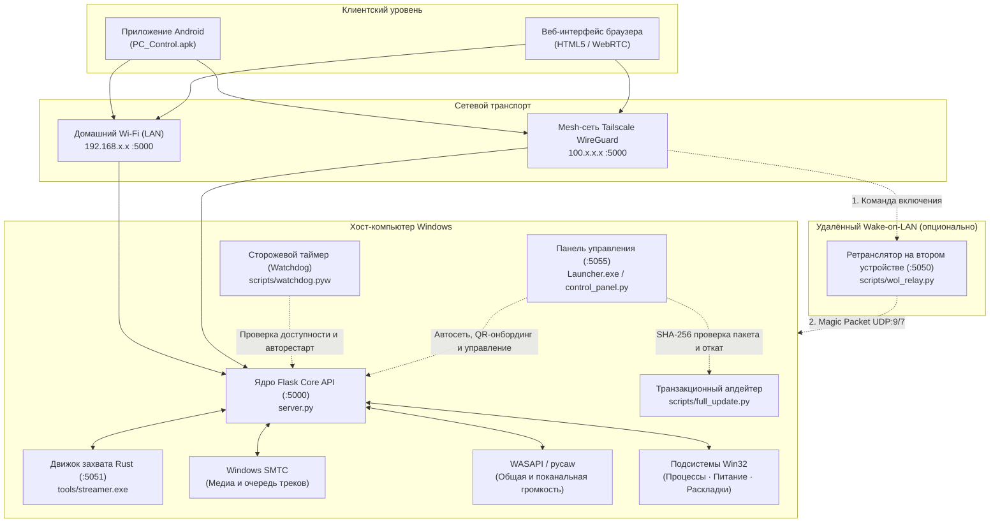

<div align="center">

<p align="center">
  <b>Русский</b> &nbsp;|&nbsp; <a href="README.md">English</a>
</p>

# PC Control

**Автономный Windows-сервис и клиентская экосистема для дистанционного администрирования ПК, управления мультимедиа, аудио/видео-трансляции (WASAPI/DXGI) и Wake-on-LAN с Android и Web.**

[-0078D6?style=flat-square&logo=windows&logoColor=white)](https://microsoft.com/windows)
[](https://github.com/lavi-666/pc-control/actions/workflows/ci.yml)
[](https://github.com/lavi-666/pc-control/releases/latest)
[](https://www.python.org/)
[](https://www.rust-lang.org/)
[](https://github.com/lavi-666/pc-control/releases/latest/download/PC_Control.apk)
[](https://tailscale.com)
[](LICENSE)

<br/>

<p align="center">
  <a href="https://github.com/lavi-666/pc-control/releases/latest/download/PC-Control-Setup.exe">
    
  </a>
  &nbsp;&nbsp;
  <a href="https://github.com/lavi-666/pc-control/releases/latest/download/PC_Control.apk">
    
  </a>
  &nbsp;&nbsp;
  <a href="https://github.com/lavi-666/pc-control/releases/latest/download/PC_Control_Windows.zip">
    
  </a>
</p>

<p align="center">
  <sub>Официальный автономный установщик <code>PC-Control-Setup.exe</code>, готовые сборки, манифест <code>release-manifest.json</code> и контрольные суммы <code>SHA256SUMS.txt</code> публикуются в <a href="https://github.com/lavi-666/pc-control/releases/latest"><b>GitHub Releases</b></a>.</sub>
</p>

</div>

---

## Содержание

- [О проекте](#о-проекте)
- [Архитектура](#архитектура)
- [Функциональные возможности](#функциональные-возможности)
- [Системные требования](#системные-требования)
- [Быстрый запуск и первичная настройка](#быстрый-запуск-и-первичная-настройка)
- [Запуск и управление сервером](#запуск-и-управление-сервером)
- [Клиентские приложения](#клиентские-приложения)
- [Удалённый доступ и Wake-on-LAN](#удалённый-доступ-и-wake-on-lan)
- [Справочник конфигурации (config.json)](#справочник-конфигурации-configjson)
- [Справочник REST API](#справочник-rest-api)
- [Модель безопасности](#модель-безопасности)
- [Тестирование и контроль качества](#тестирование-и-контроль-качества)
- [Устранение неисправностей](#устранение-неисправностей)
- [Лицензия](#лицензия)

---

## О проекте

PC Control предоставляет защищённую локальную систему дистанционного управления компьютерами под управлением Windows. Проект позволяет управлять воспроизведением медиафайлов, регулировать общую и индивидуальную громкость запущенных программ, отслеживать процессы, управлять питанием и транслировать рабочий стол вместе со звуком напрямую на смартфон или через веб-интерфейс.

Система спроектирована для работы в двух сетевых режимах:
1. **Локальная сеть (LAN)**: Работает полностью автономно в домашней сети Wi-Fi без подключения к интернету и сторонних облачных сервисов.
2. **Шифрованная сеть WireGuard (Tailscale)**: Предоставляет доступ из любой точки мира через частную подсеть `100.64.0.0/10` без проброса портов на роутере и выделенного белого IP-адреса.

Дистрибутив для Windows включает собственную изолированную среду выполнения CPython 3.12 (`runtime/`), высокопроизводительный микросервис захвата на Rust (`tools/streamer.exe`) для аппаратного дублирования экрана через DXGI и захвата звука через WASAPI Loopback, настольную панель управления (`Launcher.exe`) и фоновый супервизор (`scripts/watchdog.pyw`), обеспечивающий автоматическое восстановление при сбоях.

---

## Архитектура



### Спецификация компонентов

| Компонент | Технологический стек | Порт по умолчанию | Назначение |
|:---|:---|:---|:---|
| **Core API Server** | Python 3.12 / Flask | `TCP 5000` | Маршрутизация REST API, проверка авторизационного токена, защита от подбора пароля (`server.py`). |
| **Streaming Microservice** | Rust / DXGI / WASAPI | `TCP 5051` | Аппаратный захват экрана через DXGI, loopback-захват аудио и WebRTC-трансляция (`tools/streamer.exe`). |
| **Watchdog Supervisor** | Python (`watchdog.pyw`) | Н/Д | Фоновый сторожевой процесс, предотвращение циклических перезапусков, автовосстановление. |
| **Панель управления (Launcher)** | C# / Python HTTP server | `TCP 5055` | Графический интерфейс для автонастройки сети, подключения телефона по QR, управления сервером и обновлений (`Launcher.exe`). |
| **Система полного обновления** | Python (`full_update.py`) | Н/Д | Транзакционное обновление всего пакета из GitHub Releases с пофайловой сверкой SHA-256 и автоматическим откатом. |
| **Клиент Android** | Java / WebView / OkHttp | Динамический | Автономное мобильное приложение с поддержкой фонового воспроизведения звука (`PC_Control.apk`). |
| **Веб-клиент** | HTML5 / JavaScript | `TCP 5000` | Браузерный интерфейс управления, раздаваемый напрямую сервером. |
| **Служба WOL Relay** | Python (`wol_relay.py`) | `TCP 5050` | Сервис для включения выключенного ПК из внешней сети через второе домашнее устройство. |

### Структура репозитория

```text
pc-control/
├── Launcher.exe                 # Скомпилированный C# лаунчер и загрузчик восстановления
├── PC_Control.apk               # Готовый подписанный установочный пакет для Android
├── server.py                    # Точка входа Flask и регистрация Blueprint-модулей
├── open_app.pyw                 # Утилита быстрого открытия локального веб-пульта
├── config.example.json          # Шаблон конфигурационного файла
├── requirements.txt             # Спецификация зависимостей Python
├── requirements-runtime.lock    # Зафиксированные версии пакетов для автономной среды
├── runtime-source.json          # Дескриптор официального дистрибутива CPython 3.12
├── core/                        # Базовая инфраструктура (аутентификация, лимиты, конфиг)
│   ├── auth.py                  # Двухуровневая аутентификация и защита от брутфорса
│   ├── config.py                # Управление конфигурацией и автосинхронизация сети
│   └── logger.py                # Структурированный аудит действий и лог ошибок
├── modules/                     # Модульные Blueprint-контроллеры
│   ├── media.py                 # SMTC-контроллер и диспетчер эндпоинтов воспроизведения
│   ├── media_api.py             # Парсинг очереди и треков YouTube Music (Innertube)
│   ├── media_history.py         # Потокобезопасная история прослушивания
│   ├── media_keys.py            # Win32-эмуляция медиаклавиш и переключение окон
│   ├── media_queue.py           # Состояние живой очереди, синхронизация и автомикс
│   ├── media_uia.py             # UI Automation для вкладок браузера и DOM-элементов
│   ├── media_volume.py          # WASAPI-регулировка громкости сессии медиаплеера
│   ├── power.py                 # Выключение, перезагрузка, сон, блокировка и Wake-on-LAN
│   ├── presets.py               # Многошаговые сценарии запуска с нечётким поиском программ
│   ├── streaming.py             # Прокси трансляции экрана и WASAPI-аудио в WebRTC
│   ├── system.py                # Диспетчер задач, завершение процессов, раскладки клавиатуры
│   └── volume.py                # Мастер-громкость и поканальный WASAPI-микшер
├── web/                         # Ресурсы веб-интерфейса и шаблоны панелей
│   ├── index.html               # Семантическая разметка веб-клиента
│   ├── css/styles.css           # Стили и адаптивная вёрстка
│   ├── js/                      # Модульная архитектура клиентского скрипта
│   │   ├── i18n.js              # Мультиязычные словари локализации (uk, ru, en)
│   │   ├── stream.js            # Контроллеры WebRTC аудио- и видеотрансляции
│   │   ├── media.js             # Таймлайн плеера, живая очередь и история треков
│   │   ├── presets.js           # Редактор сценариев запуска и движок выполнения
│   │   └── app.js               # Роутер подключения, выбор сети и системный интерфейс
│   └── control_panel.html       # Разметка панели управления Launcher (:5055, ~190 КБ)
├── scripts/                     # Утилиты управления, автосети, обновления и сборки
│   ├── Launcher.cs              # Исходный код настольного лаунчера на C#
│   ├── control_panel.py         # Сервер панели управления Launcher (:5055)
│   ├── full_update.py           # Транзакционный апдейтер полного пакета с откатом
│   ├── network_setup.py         # Автоопределение LAN IP/MAC и Tailscale + проверка ЭЦП
│   ├── manage_server.py         # Контроллер запуска, остановки и проверки своего инстанса
│   ├── bootstrap_runtime.ps1    # Автоматическая развёртка автономного CPython 3.12
│   ├── build_runtime.py         # Сборщик портативного окружения Python для релизов
│   ├── package_windows.py       # Упаковщик дистрибутива Windows ZIP и release-manifest.json
│   ├── build_apk.py             # Автосборка APK с динамической подстановкой ассетов
│   ├── configure.py             # Интерактивный консольный мастер настройки
│   ├── change_password.py       # Утилита смены и ротации пароля доступа
│   ├── setup_autologon.ps1      # Настройка Wake-on-LAN сетевой карты и автовхода netplwiz
│   ├── apply_firewall_rule.bat  # Правило брандмауэра Windows для Private/Tailscale
│   ├── wol_relay.py             # Автономный ретранслятор пакетов Wake-on-LAN
│   └── watchdog.pyw             # Фоновый сторожевой процесс (Watchdog)
├── streamer_rs/                 # Исходный код микросервиса захвата DXGI/WASAPI на Rust
├── android_app/                 # Исходный код Android-приложения (WebView + фоновый звук)
├── docs/                        # Документация проекта и отчёты технических аудитов
└── tests/                       # 650 регрессионных тестов API + 64 теста релиза и лаунчера
```

---

## Функциональные возможности

### 1. Управление медиаплеером и живой очередью (Windows SMTC)
- Интеграция с системным транспортом мультимедиа Windows (`Windows.Media` через WinSDK).
- Двусторонняя синхронизация с проигрывателями: YouTube Music, Spotify, десктопными плеерами и медиавкладками браузеров.
- Считывание метаданных трека: название, исполнитель, обложка альбома, длительность и прогресс воспроизведения.
- Навигация по живой очереди: просмотр, поиск треков в YouTube Music, добавление, удаление и переключение композиций.
- Сохранение истории прослушивания в `listening_history.json`.

### 2. Управление звуком и микшер приложений
- Регулировка мастер-громкости системы и переключение режима без звука (Mute) через Windows Core Audio (WASAPI).
- Поканальный микшер приложений: опрос активных аудиосессий (игры, браузеры, голосовые чаты) с раздельной регулировкой громкости и отключением звука для каждого процесса.
- Потокобезопасная инициализация COM-интерфейсов, корректная работа на системах без аудиовыхода (headless) и кэширование параметров громкости.

### 3. Трансляция рабочего стола и системного звука
- Аппаратный захват экрана с помощью нативного микросервиса на Rust (`tools/streamer.exe`), использующего DirectX Graphics Infrastructure (DXGI) Desktop Duplication API.
- Определение конфигурации нескольких мониторов и переключение между ними на лету.
- Передача звука системы через WASAPI Loopback по протоколу WebRTC (кодек Opus, 48 кГц stereo) или потоковому аудиоканалу.
- Поддержка фонового воспроизведения звука на Android (трансляция аудио продолжается при заблокированном экране смартфона).

### 4. Управление процессами и администрирование
- Монитор активных пользовательских процессов с автоматической фильтрацией системных служб.
- Принудительное завершение зависших процессов в один клик (`taskkill`).
- Переключение языка ввода: запрос списка установленных раскладок Windows и переключение (`WM_INPUTLANGCHANGEREQUEST` / Win32 HKL).
- Мгновенное создание скриншота всех мониторов (`/screenshot`).
- Журнал аудита действий с последовательной записью в `actions_log.jsonl`.

### 5. Управление питанием и Wake-on-LAN
- Команды питания: завершение работы, перезагрузка, перевод в спящий режим (ACPI S3) и блокировка экрана (`LockWorkStation`).
- Таймер отложенного выключения (`/shutdown_timer`) с отслеживанием оставшегося времени и отменой в любой момент.
- Локальный Wake-on-LAN: отправка UDP Magic Packet (порты 7 и 9) по широковещательным адресам подсети.
- Удалённый Wake-on-LAN: пересылка сигнала пробуждения через домашний ретранслятор (`scripts/wol_relay.py`).

### 6. Сценарии запуска (Launch Presets)
- Настраиваемые цепочки автоматизации, хранящиеся в файле `launch_presets.json`.
- Поддерживаемые шаги: запуск программ (с автоматическим поиском установленного ПО через `/api/programs/search`), открытие ссылок в браузере и настраиваемые паузы между шагами.
- Асинхронное выполнение цепочки с индикацией текущего шага и возможностью экстренной остановки.

### 7. Автономная среда, автонастройка сети и полное обновление
- **Независимая среда Python (`runtime/`)**: Полный архив включает собственную сборку CPython 3.12 и все библиотеки — установка системного Python или запуск `pip` пользователем не требуются.
- **Автоматическое определение сети (`auto_network`)**: Автоматически определяет IPv4-адрес и физический MAC-адрес основного сетевого адаптера маршрута, а также активный IPv4-адрес Tailscale (`BackendState == Running`), поддерживая актуальность `config.json`.
- **Подключение телефона в один клик (`Подключить телефон · QR`)**: Автоматически запускает сервер (если он остановлен) и формирует QR-код с актуальным сетевым адресом, портом и токеном для мгновенного входа в браузерный пульт и скачивания `PC_Control.apk`.
- **Транзакционное полное обновление (`scripts/full_update.py`)**: Загружает официальный архив релиза, сверяет `SHA256SUMS.txt` и SHA-256 каждого файла из `release-manifest.json`, обновляет все компоненты (включая `Launcher.exe`, `PC_Control.apk` и `runtime/`), сохраняет пользовательские настройки и автоматически откатывает изменения при любой ошибке запуска.

### 8. Надёжность и сторожевой процесс (Watchdog)
- Независимый фоновый супервизор (`scripts/watchdog.pyw`) опрашивает работоспособность сервера каждые 30 секунд.
- Защита от запуска дубликатов через системный мьютекс (`Local\PCControlWatchdogMutex`).
- Автоматический перезапуск сервера при фиксации двух последовательных неудачных проверок.
- Защита от бесконечного цикла падений: не более 5 перезапусков в течение 150 секунд.
- Корректная обработка штатной остановки через сигнальный файл `manual_stop.flag`.

---

## Системные требования

### Хост-компьютер (Windows)
- **Операционная система**: Windows 10 (версия 1809 или новее) или Windows 11 (64-бит).
- **Python**: Встроен в полный дистрибутив `PC_Control_Windows.zip` (`runtime/`) вместе со всеми библиотеками; установка Python и `pip` в систему не требуется. При запуске из архива исходного кода (`git clone` / `Download ZIP`) лаунчер автоматически скачивает и разворачивает изолированную среду `runtime/` при первом старте (потребуется интернет).
- **Свободное место на диске**: ~250 МБ для установленного приложения; не менее 3 ГБ свободного места для выполнения транзакционного полного обновления.
- **Сетевая карта**: Для поддержки Wake-on-LAN рекомендуется проводное подключение через Ethernet.

### Клиентские устройства
- **Android**: Android 8.0 (API level 26) или новее.
- **Веб-браузер**: Любой современный браузер с поддержкой HTML5, WebSockets и WebRTC (Chrome, Edge, Firefox, Safari).

---

## Быстрый запуск и первичная настройка

Проект полностью автоматизирован «из коробки». Обычному пользователю не требуется вручную настраивать виртуальные окружения, запускать консольные команды `pip` или редактировать конфигурационные файлы.

### 1. Скачайте проект

- **Вариант 1 — Автономный установщик Windows (Рекомендуется для большинства пользователей)**:
  Скачайте [**PC-Control-Setup.exe**](https://github.com/lavi-666/pc-control/releases/latest/download/PC-Control-Setup.exe) из раздела [GitHub Releases](https://github.com/lavi-666/pc-control/releases/latest).
  Запустите файл. Мастер установки предложит выбрать каталог (по умолчанию `%LocalAppData%\Programs\PC Control` — не требует прав администратора), создаст ярлыки на Рабочем столе и в меню «Пуск», зарегистрирует приложение в Windows «Установленные приложения» и автоматически откроет Центр управления PC Control.
- **Вариант 2 — Полный портативный дистрибутив (Портативный ZIP)**:
  Скачайте [**PC_Control_Windows.zip**](https://github.com/lavi-666/pc-control/releases/latest/download/PC_Control_Windows.zip) и распакуйте папку `PC_Control` целиком в любое место на диске. Архив уже содержит Python 3.12 и библиотеки в папке `runtime/` — первый запуск не требует интернета. Запустите `Launcher.exe`.
- **Вариант 3 — Клонирование репозитория из исходников**:
  ```cmd
  git clone https://github.com/lavi-666/pc-control.git
  cd pc-control
  Launcher.exe
  ```
  При первом запуске `Launcher.exe` автоматически развернёт изолированную среду `runtime/` через `scripts/bootstrap_runtime.ps1`.

### 2. Запустите программу и настройте подключение
После запуска **Launcher.exe автоматически выполняет всю подготовку**:
1. **Среда выполнения**: Использует изолированный Python из `runtime/` независимо от системного Python.
2. **Конфигурация и автосеть**: Создаёт `config.json`, автоматически определяет IPv4-адрес и MAC-адрес физического сетевого адаптера (исключая виртуальные интерфейсы VirtualBox/VMware/Hamachi/WSL), проверяет подключение Tailscale и генерирует криптографически стойкий пароль доступа.
3. **Подключение телефона**: Нажмите **Подключить телефон · QR**. Лаунчер запустит сервер, проверит доступность порта и покажет QR-код. Отсканируйте его камерой смартфона — откроется мобильный веб-пульт либо приложение `PC_Control.apk` по схеме `pccontrol://connect`.

---

### Удаление программы и безопасный откат настроек Windows (Uninstall.exe)

Удалить PC Control можно в любой момент:
- Через **Параметры Windows → Приложения → Установленные приложения → PC Control → Удалить**.
- Запуском [`Uninstall.exe`](file:///C:/Users/leon4/Downloads/serverPS/pc-control-main/pc-control-main/Uninstall.exe) из папки программы или ярлыка «Удалить PC Control» в меню «Пуск».
- В панели управления лаунчера по кнопке **Удалить программу**.

`Uninstall.exe` работает автономно (не зависит от Python), безопасно останавливает только процессы PC Control, сверяется с журналом `logs/system_state_journal.json`, аккуратно восстанавливает исходные параметры Windows Hello и Hiberboot (с разрешением возможных конфликтов, если пользователь менял их вручную), удаляет созданные правила брандмауэра и ярлыки, а затем выполняет самоликвидацию.

---

### Дополнительная и расширенная настройка

Все параметры можно изменять прямо в графическом интерфейсе Launcher. Для серверов без графической оболочки или продвинутого администрирования также доступны скрипты:

#### Брандмауэр Windows Defender (Рекомендуется для доступа по сети)
Чтобы разрешить входящие подключения клиентов из домашней сети и Tailscale с защитой от внешнего интернета, нажмите кнопку **Настроить** у шага Брандмауэра в чек-листе панели, либо выполните:
```cmd
scripts\apply_firewall_rule.bat
```
Скрипт запросит права Администратора (UAC) и создаст правило для настроенного порта сервера (по умолчанию `5000`) с ограничением частным профилем сети (`Private`) и подсетями `LocalSubnet` и Tailscale (`100.64.0.0/10`).

#### Смена пароля и консольный мастер настройки
Изменить пароль доступа можно прямо в окне Launcher по кнопке **Изменить**, запуском `change_password.bat`, либо через интерактивный консольный мастер:
```cmd
scripts\configure.bat
```

---

## Запуск и управление сервером

### Способ 1: Графическая панель управления (Launcher)
Запустите графическое приложение:
```cmd
Launcher.exe
```
*(Или выполните `launcher.bat`)*

Панель запускает локальный сервис управления на `http://127.0.0.1:5055` и открывает окно лаунчера. В панели отображаются актуальные сетевые адреса, статус сервера и Tailscale, окно подключения телефона по QR, живой терминал логов и настройки автовхода Windows.

Ключевые возможности Launcher:
- **Автоматическая и ручная проверка обновлений**: При запуске и по кнопке **Проверить обновления** лаунчер опрашивает последний релиз GitHub и сверяет контрольные суммы всех управляемых файлов с `release-manifest.json`.
- **Полное транзакционное обновление через лаунчер**: Кнопка **Обновить сейчас** загружает официальный архив `PC_Control_Windows.zip`, проверяет `SHA256SUMS.txt` и SHA-256 каждого файла в `release-manifest.json`, создаёт резервную копию и обновляет весь пакет: `Launcher.exe`, сервер, веб-интерфейс, модули, утилиты, `PC_Control.apk` и `runtime/`. Пользовательские файлы (`config.json`, `launch_presets.json`, логи) полностью сохраняются. Отдельный процесс проверяет успешный запуск после обновления и автоматически выполняет откат при сбое; прерванное обновление восстанавливается при следующем запуске `Launcher.exe`. Подробнее: [docs/FULL_PROJECT_UPDATES.ru.md](docs/FULL_PROJECT_UPDATES.ru.md).
- **Автоопределение сети (`Авто IP / MAC / VPN`)**: Определяет и сохраняет актуальные LAN IP, физический MAC-адрес выбранного адаптера и IPv4-адрес Tailscale, включая режим автоматической синхронизации (`auto_network: true`).
- **Очистка профилей и кэша браузеров**: Встроенная функция обслуживания для удаления временных профилей и кэша веб-компонентов.
- **Ротация токена**: Безопасная генерация нового случайного токена в один клик с мгновенным сохранением.

### Способ 2: Фоновый запуск службы
Для скрытой работы без отображения окон:
- **Запуск**: Запустите `start_server.bat` (или `scripts\3_start_server.bat`). Через `scripts/manage_server.py` и встроенный `runtime/pythonw.exe` будут запущены `server.py` и сторожевой процесс `scripts\watchdog.pyw`.
- **Остановка**: Запустите `stop_server.bat`. Корректно завершит процессы `server.py`, `watchdog.pyw` и `tools\streamer.exe` данной установки.
- **Запуск в терминале (для отладки)**:
  ```cmd
  runtime\python.exe server.py
  ```

---

## Клиентские приложения

### Веб-интерфейс
Откройте браузер на смартфоне, планшете или другом компьютере в той же сети (или в сети Tailscale) и перейдите по адресу:
```text
http://<IP_КОМПЬЮТЕРА>:5000/
```
Введите токен авторизации из `config.json` (или отсканируйте QR-код в окне **Подключить телефон · QR** для автоматического входа).

### Приложение для Android
1. Установите `PC_Control.apk` на Android-устройство (файл находится в корне проекта, также доступен по кнопке скачивания в веб-пульте и в GitHub Releases).
2. Запустите приложение и укажите адрес сервера (`http://192.168.x.x:5000` или `http://100.x.x.x:5000`) и токен доступа.
3. Для пересборки подписанного APK из исходного кода:
   ```cmd
   runtime\python.exe scripts/build_apk.py
   ```
   Скрипт использует автономный инструментарий Android SDK (`aapt2`, `d8`, `zipalign`, `apksigner`) и формирует подписанный пакет (схемы подписи v2 и v3) без необходимости установки Android Studio.

---

## Удалённый доступ и Wake-on-LAN

### Удалённый доступ через Tailscale
Для управления компьютером вне дома без настройки роутера и проброса портов:
1. Нажмите кнопку подключения **Tailscale VPN** в `Launcher.exe` (лаунчер автоматически скачает официальный установщик с `pkgs.tailscale.com`, проверит цифровую подпись Authenticode и запустит установку) либо установите [Tailscale](https://tailscale.com) вручную.
2. Установите приложение Tailscale на смартфон из Google Play или App Store.
3. Авторизуйтесь под одной и той же учётной записью на обоих устройствах.
4. После подключения `Launcher.exe` автоматически определит активный IPv4-адрес Tailscale (`100.x.x.x`) и сохранит его в `vpn_ip`. Весь трафик передаётся внутри сквозного шифрованного туннеля WireGuard.

### Настройка включения по сети (Wake-on-LAN)

#### 1. Параметры BIOS/UEFI материнской платы
Включите дежурное питание сетевого адаптера:
- Переведите **Wake on LAN**, **Resume by Onboard LAN** или **Resume by PCI-E Device** в значение **Enabled**.
- Переведите **ErP Ready** / **Deep Sleep** в значение **Disabled** (активный режим ErP полностью обесточивает сетевой порт при выключении ПК).

#### 2. Конфигурация сетевой карты и автовхода в Windows
Запустите скрипт настройки от имени Администратора (или нажмите кнопку настройки автовхода в `Launcher.exe`):
```cmd
scripts\2_setup_autologon.cmd
```
Скрипт (`scripts/setup_autologon.ps1`) автоматически:
- Активирует параметры обработки Magic Packet в драйвере сетевой карты (`*WakeOnMagicPacket = 1`).
- Отключает быстрый запуск Windows (`HiberbootEnabled = 0`), который препятствует приёму пакета включения.
- Добавляет ярлык запуска сервера в автозагрузку Windows.
- Устанавливает параметр реестра `DevicePasswordLessBuildVersion = 0` и открывает системную утилиту `netplwiz`.

> [!IMPORTANT]
> При настройке автоматического входа в окне `netplwiz` обязательно вводите **пароль вашей учётной записи Microsoft/Windows**, а не короткий PIN-код Windows Hello. Указание PIN-кода приведёт к ошибке авторизации при загрузке.

#### 3. Ретранслятор включения вне дома (WOL Relay)
Выключенный компьютер не поддерживает активное VPN-соединение. Для его удалённого включения через интернет:
1. Запустите скрипт `scripts/wol_relay.py` на дополнительном устройстве, постоянно находящемся в домашней сети Wi-Fi (например, на втором смартфоне с Termux или домашнем мини-ПК):
   ```bash
   python scripts/wol_relay.py
   ```
2. Ретранслятор ожидает команды на порту `5050`. В настройках сети `Launcher.exe` (и в мобильном клиенте) укажите его IP-адрес Tailscale (например, `100.64.0.2`).
3. При нажатии кнопки включения команда поступит на ретранслятор, который разошлёт широковещательный UDP Magic Packet по домашней локальной сети.

---

## Справочник конфигурации (config.json)

Параметры сохраняются в файле `config.json` в корневой директории проекта:

```json
{
  "auto_network": true,
  "token": "ваш_секретный_пароль",
  "lan_ip": "192.168.0.100",
  "vpn_ip": "100.64.0.1",
  "wol_relay_ip": "100.64.0.2",
  "mac_address": "AA-BB-CC-DD-EE-FF",
  "port": 5000,
  "relay_port": 5050,
  "language": "ru",
  "cors_allowed_origins": [
    "http://localhost:*",
    "http://127.0.0.1:*",
    "http://192.168.*",
    "http://100.*",
    "http://10.*"
  ]
}
```

| Параметр | Тип | По умолчанию | Описание |
|:---|:---|:---|:---|
| `auto_network` | `boolean` | `true` | Автоматическая синхронизация `lan_ip`, `mac_address` и `vpn_ip` с активным сетевым адаптером Windows и статусом Tailscale. Отключается при ручном редактировании адресов; включается кнопкой **Авто IP / MAC / VPN**. |
| `token` | `string` | *(генерируется)* | Секретный токен авторизации (`secrets.token_hex`). Передаётся в заголовке `X-Auth-Token`, `Authorization: Bearer`, параметре `?token=`, cookie или через `/api/auth/login`. |
| `lan_ip` | `string` | `""` *(авто)* | Локальный IPv4-адрес компьютера в домашней сети. |
| `vpn_ip` | `string` | `""` *(авто)* | Виртуальный IPv4-адрес компьютера (`100.x.x.x`) при активном подключении Tailscale. |
| `wol_relay_ip` | `string` | `""` | IPv4 / Tailscale-адрес устройства-ретранслятора для Wake-on-LAN вне дома. |
| `mac_address` | `string` | `""` *(авто)* | Физический MAC-адрес выбранного сетевого адаптера для формирования Magic Packet. |
| `port` | `integer` | `5000` | TCP-порт основного сервера Flask и веб-клиента (не должен пересекаться с `5050`–`5055`). |
| `relay_port` | `integer` | `5050` | TCP-порт службы ретрансляции Wake-on-LAN (`wol_relay.py`). |
| `language` | `string` | `"ru"` | Код языка интерфейса (`"en"`, `"ru"`, `"uk"`). |
| `cors_allowed_origins` | `array` | `["http://localhost:*", ...]` | Белый список разрешённых HTTP `Origin` заголовков CORS. Поддерживает маски подсетей для локальных сетей и Tailscale. |

Для быстрой смены пароля доступа из командной строки запустите:
```cmd
change_password.bat
```

---

## Справочник REST API

Все защищённые запросы требуют авторизации через заголовок `X-Auth-Token`, `Authorization: Bearer <token>`, сессионную cookie или поле `token` в JSON-теле запроса.

### Статус, авторизация и служебные маршруты

| Метод | Эндпоинт | Пример полезной нагрузки | Описание |
|:---|:---|:---|:---|
| `GET` | `/status` | Н/Д | Возвращает статус сервера (`"online"`), идентификатор инстанса (`instance`), имя хоста и состояние таймеров. |
| `GET` | `/history` | Н/Д | Возвращает список последних действий из журнала аудита `actions_log.jsonl`. |
| `POST` | `/api/auth/login` | `{"token": "..."}` | Проверяет токен и устанавливает сессионную `HttpOnly` cookie. |
| `GET/POST` | `/api/auth/verify` | Н/Д | Проверяет действительность токена и возвращает статус блокировки. |
| `POST` | `/api/auth/rotate` | Н/Д | Генерирует и сохраняет новый случайный токен доступа. |
| `GET` | `/api/lan_info` | Н/Д | Возвращает настроенные адреса LAN/VPN, порты и ссылки подключения. |
| `GET` | `/download/apk` | Н/Д | Скачивание готового подписанного пакета `PC_Control.apk`. |
| `GET` | `/download/wol_relay.py` | Н/Д | Скачивание скрипта ретранслятора `wol_relay.py`. |

### Управление громкостью и микшер приложений

| Метод | Эндпоинт | Пример полезной нагрузки | Описание |
|:---|:---|:---|:---|
| `GET` | `/volume` | Н/Д | Возвращает процент общей системной громкости (`percent`) и флаг `muted`. |
| `POST` | `/volume` | `{"percent": 45}` | Устанавливает общую системную громкость (`0`–`100`). |
| `POST` | `/mute` | `{"mute": true}` | Включает или выключает звук системы (Mute). |
| `GET` | `/app_volumes` | Н/Д | Возвращает список активных аудиосессий приложений (`pid`, `name`, `percent`, `muted`). |
| `POST` | `/app_volume` | `{"pid": 4820, "percent": 70}` | Регулирует громкость конкретного приложения по PID (`0`–`100`). |
| `POST` | `/app_volume/mute` | `{"pid": 4820, "mute": true}` | Включает или выключает звук для процесса по PID. |

### Медиаплеер (SMTC и очередь YouTube Music)

| Метод | Эндпоинт | Пример полезной нагрузки | Описание |
|:---|:---|:---|:---|
| `GET` | `/media/now` | Н/Д | Возвращает статус активного плеера, название, исполнителя, позицию, длительность и обложку. |
| `POST` | `/media/control` | `{"action": "play_pause"}` | Команды управления плеером (`play_pause`, `next`, `prev`, `stop`, `repeat`, `shuffle`, `seek`). |
| `POST` | `/media/volume` | `{"percent": 80}` | Регулирует громкость активного медиаплеера. |
| `POST` | `/media/mode` | `{"mode": "normal"}` | Переключает режим работы контроллера мультимедиа. |
| `GET` | `/media/queue` | Н/Д | Возвращает живую очередь воспроизведения (`tracks`) и историю (`history`). |
| `POST` | `/media/queue/refresh` | Н/Д | Принудительно обновляет живую очередь активного плеера. |
| `POST` | `/media/queue/play` | `{"index": 2}` | Запускает воспроизведение выбранного трека из очереди. |
| `POST` | `/media/queue/play_next` | `{"video_id": "..."}` | Ставит трек следующим в очередь воспроизведения. |
| `POST` | `/media/queue/add` | `{"video_id": "..."}` | Добавляет трек в конец очереди. |
| `POST` | `/media/queue/remove` | `{"index": 2}` | Удаляет трек из очереди по индексу. |
| `GET` | `/media/search` | `?q=исполнитель+трек` | Поиск треков в YouTube Music с возвратом метаданных и `video_id`. |
| `POST` | `/media/history/play` | `{"video_id": "..."}` | Запускает трек из сохранённой истории прослушивания. |

### Процессы, раскладки клавиатуры и скриншоты

| Метод | Эндпоинт | Пример полезной нагрузки | Описание |
|:---|:---|:---|:---|
| `GET` | `/processes` | Н/Д | Возвращает отсортированный список пользовательских процессов (`name`, `pid`). |
| `POST` | `/processes/kill` | `{"pid": 10240}` | Принудительно завершает процесс по PID (`taskkill /PID /T /F`). |
| `GET` | `/keyboard/languages` | Н/Д | Возвращает текущую и установленные раскладки клавиатуры (`current`, `languages`). |
| `POST` | `/keyboard/switch_language` | Н/Д | Переключает раскладку ввода на следующую по списку. |
| `POST` | `/keyboard/set_language` | `{"hkl": "0x04090409"}` | Активирует конкретную раскладку клавиатуры по идентификатору HKL. |
| `GET` | `/screenshot` | Н/Д | Делает и возвращает PNG-скриншот рабочего стола. |

### Управление питанием, таймер сна и Wake-on-LAN

| Метод | Эндпоинт | Пример полезной нагрузки | Описание |
|:---|:---|:---|:---|
| `POST` | `/action` | `{"action": "shutdown"}` | Выполняет системное действие (`shutdown`, `restart`, `sleep`, `lock`, `launch_cs2`). |
| `POST` | `/shutdown_timer` | `{"minutes": 45}` | Запускает таймер отложенного выключения (`1`–`1440` минут). |
| `POST` | `/shutdown_timer/cancel` | Н/Д | Отменяет активный таймер выключения. |
| `GET` | `/shutdown_timer/status` | Н/Д | Возвращает оставшееся время активного таймера выключения. |
| `POST` | `/api/wol` | `{"mac": "AA-BB-CC-DD-EE-FF"}` | Рассылает широковещательный UDP Magic Packet (и пересылает запрос на `wol_relay_ip`). |

### Трансляция экрана/звука и сценарии запуска (Presets)

| Метод | Эндпоинт | Пример полезной нагрузки | Описание |
|:---|:---|:---|:---|
| `POST` | `/webrtc/offer` | `{"sdp": "...", "type": "offer"}` | Согласование сессии WebRTC через `tools/streamer.exe` для передачи видео и звука. |
| `POST` | `/webrtc/close` | `{"session_id": "..."}` | Закрывает активную сессию WebRTC. |
| `GET` | `/screen/monitors` | Н/Д | Возвращает список подключённых мониторов и их разрешений. |
| `POST` | `/screen/config` | `{"monitor": 0, "fps": 30, "height": 720}` | Изменяет монитор захвата, целевой FPS, качество и высоту кадра. |
| `GET/POST` | `/screen/volume` | `{"percent": 80, "muted": false}` | Чтение или изменение громкости и Mute аудиопотока трансляции. |
| `GET` | `/screen/stream` | Н/Д | Потоковая MJPEG-видеотрансляция экрана (совместимый режим). |
| `GET` | `/audio` | Н/Д | Потоковая передача системного аудио WASAPI Loopback. |
| `GET` | `/api/presets` | Н/Д | Возвращает сохранённые сценарии запуска и статус текущего выполнения. |
| `POST` | `/api/presets/save` | `{"name": "Игры", "steps": [...]}` | Создаёт или обновляет многошаговый сценарий запуска. |
| `POST` | `/api/presets/delete` | `{"id": "..."}` | Удаляет сценарий запуска по идентификатору. |
| `POST` | `/api/presets/run` | `{"id": "..."}` | Запускает асинхронное выполнение выбранного сценария. |
| `POST` | `/api/presets/cancel` | Н/Д | Экстренно останавливает выполняющийся сценарий. |
| `GET` | `/api/presets/status` | Н/Д | Возвращает прогресс активного сценария запуска. |
| `GET` | `/api/programs/search` | `?q=steam` | Поиск установленных программ Windows для добавления в сценарии запуска. |

---

## Модель безопасности

- **Полное отсутствие зашитых паролей**: В кодовой базе нет статических паролей по умолчанию. Для каждой новой установки токен генерируется индивидуально с высокой криптографической энтропией (`secrets.token_hex`) и сохраняется в `config.json`.
- **Проверка токена за константное время**: Все операции сравнения паролей используют метод `secrets.compare_digest`, исключающий атаки по времени ответа (timing attacks).
- **Двухуровневая защита от подбора паролей (Brute-Force Rate Limiting)**:
  - Окно анализа попыток: **120 секунд** (`LOCKOUT_WINDOW = 120s`).
  - **Внешние / публичные IP-адреса**: При превышении **5 неудачных попыток** за 120 секунд IP-адрес блокируется на **180 секунд (3 минуты)** (`LOCKOUT_MAX_ATTEMPTS = 5`, `LOCKOUT_DURATION = 180s`).
  - **Доверенные локальные и mesh-сети** (RFC 1918 `192.168.0.0/16`, `10.0.0.0/8`, `172.16.0.0/12`, loopback `127.0.0.1` и Tailscale CGNAT `100.64.0.0/10`): Порог увеличен до **15 неудачных попыток** за 120 секунд, а блокировка составляет **30 секунд** (`LOCKOUT_LAN_MAX = 15`, `LOCKOUT_LAN_DURATION = 30s`).
  - **Персистентность блокировок**: Список заблокированных адресов сохраняется на диск в `logs/lockouts.json`, что защищает от сброса кулдауна перезагрузкой сервера.
  - **Мгновенный сброс**: Успешный ввод пароля мгновенно очищает историю неудачных попыток для текущего IP. Смена пароля через `Launcher.exe` или `change_password.bat` сбрасывает все активные ограничения.
- **Строгая изоляция тестового режима (Environment-Only)**:
  - Тестовый и безопасный режимы (`safe_mode`) не могут быть активированы через клиентские HTTP-заголовки (например, `X-Safe-Mode`).
  - Переключение режима возможно исключительно через системные переменные окружения процесса сервера (`PC_CONTROL_TEST_MODE=1` или `SAFE_TEST_MODE=1`).
- **Защита локальной панели управления от CSRF и DNS Rebinding**:
  - Сервис панели управления (`127.0.0.1:5055`) строго проверяет заголовки `Host` и `Origin`, отклоняя запросы со сторонних сайтов кодом `403 Forbidden`, и ограничивает размер POST-запросов до 64 КБ.
- **Контроль источников CORS с поддержкой масок подсетей**:
  - Все входящие HTTP-заголовки `Origin` на основном сервере валидируются по списку `cors_allowed_origins` из `config.json`.
  - Поддерживаются шаблоны подсетей (`http://localhost:*`, `http://192.168.*`, `http://100.*`, `http://10.*`), блокирующие обращения со сторонних веб-страниц кодом `403 Forbidden`.
- **Криптографическая верификация релизов и транзакционных обновлений**:
  - Полные обновления (`scripts/full_update.py`) принимают только официальные релизы из репозитория `github.com/lavi-666/pc-control`, содержащие `PC_Control_Windows.zip`, `release-manifest.json` и `SHA256SUMS.txt`.
  - До замены любого файла на диске сверяются SHA-256 всего архива и SHA-256 каждого отдельного файла в `release-manifest.json`.
  - Валидатор путей (`managed_name`) блокирует выход за пределы директории (`..`), зарезервированные имена устройств Windows (`CON`, `NUL`, `COM1` и др.), коллизии регистра и любые попытки перезаписи пользовательских данных (`config.json`, `launch_presets.json`).
  - Установка выполняется из изолированной копии Python с проверкой запуска обновлённой панели и сервера и автоматическим откатом из резервной копии при ошибке.
- **Ограничение сетевого профиля Windows Defender**:
  - Правило брандмауэра привязывает доступ к порту сервера исключительно к частным профилям сети (`Private`), разрешая трафик только из `LocalSubnet` и подсети Tailscale `100.64.0.0/10`.

---

## Тестирование и контроль качества

В репозитории предусмотрены два автоматических тестовых контура, выполняемых в GitHub Actions при каждом коммите:

### 1. Тесты системы обновлений, дистрибутива, лаунчера и автосети (64 теста)
Проверяют транзакционный апдейтер, защиту архивов, сборку пакета без утечки пользовательских секретов, HTTP API панели лаунчера (`:5055`) и логику автоопределения сети в изолированных временных папках:

```cmd
runtime\python.exe -m unittest tests.test_update_system tests.test_distribution_audit tests.test_launcher_audit tests.test_network_setup -v
```

### 2. Полный регрессионный комплекс сервера (650 циклов)
Покрывает все 26 функциональных пакетов (650 тестовых циклов) в безопасном тестовом режиме:

```cmd
set PC_CONTROL_TEST_MODE=1
set SAFE_TEST_MODE=1
runtime\python.exe tests/run_all_650_tests.py
```

Тестовый набор включает 26 модульных пакетов:
1. Базовые контракты API и авторизационные заголовки
2. Граничные значения и усечение параметров
3. Устойчивость к некорректным данным, SQLi и XSS-инъекциям
4. Генерация пакетов Wake-on-LAN и взаимодействие с ретранслятором
5. Проверка окружения и обработка исключений
6. Стресс-тестирование параллельными запросами и блокировки
7. Интеграция с медиатранспортом Windows SMTC
8. Аудио-подсистема и WASAPI Loopback захват
9. Сигнализация WebRTC SDP и мониторы
10. Переключение раскладок Win32
11. Диспетчер задач и принудительное завершение процессов
12. Сохранение журнала аудита и ротация логов
13. Широковещательная отправка сетевых пакетов
14. Соответствие протоколу HTTP и MIME-типы
15. Защита от Path Traversal и блокировка перебора
16. Заголовки CORS для всех маршрутов
17. Числовые экстремумы (NaN, Infinity, переполнения)
18. Диапазонные запросы статических ресурсов (HTTP Ranges)
19. Жизненный цикл TCP-сокетов и сброс соединений
20. Эмуляция сетевого стека клиента OkHttp
21. Граничные сценарии индивидуальных аудиосессий приложений
22. Конкурентные смешанные нагрузки
23. Устойчивость к фальсификации запросов (Request Smuggling)
24. Профилирование утечек памяти при длительной нагрузке
25. Детерминированное многопроходное фаззинг-тестирование
26. Кросс-модульная проверка системных инвариантов

---

## Устранение неисправностей

### Клиент не может подключиться по локальному Wi-Fi
- Убедитесь, что в свойствах сетевого подключения Windows выбран тип **Частная сеть** (Параметры → Сеть и интернет → Свойства). На общедоступных сетях Windows блокирует входящие порты.
- Нажмите кнопку **Настроить** у шага Брандмауэра в `Launcher.exe` (или запустите `scripts\apply_firewall_rule.bat` от имени Администратора).
- Проверьте, что компьютер и смартфон подключены к одной подсети роутера (без изоляции гостевой сети Wi-Fi).

### Компьютер запрашивает пароль или PIN-код после включения по сети
- Запустите `scripts\2_setup_autologon.cmd` от имени Администратора.
- В окне `netplwiz` снимите флажок *«Требовать ввод имени пользователя и пароля»*, нажмите **Применить** и введите **полный пароль учётной записи** (не PIN-код Windows Hello).
- Убедитесь, что параметр реестра `HKLM\SOFTWARE\Microsoft\Windows NT\CurrentVersion\PasswordLess\Device\DevicePasswordLessBuildVersion` имеет значение `0`.

### Компьютер не включается по сигналу Wake-on-LAN
- Войдите в BIOS/UEFI материнской платы и проверьте, что опция **Wake on LAN** / **Resume by PCI-E Device** включена, а параметр **ErP Ready** отключён.
- Убедитесь, что светодиодный индикатор на разъёме сетевой карты продолжает светиться после выключения ПК.
- Запустите утилиту диагностики адаптера в командной строке:
  ```cmd
  runtime\python.exe tools/diag_wol.py
  ```

### Восстановление среды `runtime/` и библиотек Python
- Если папка `runtime/` отсутствует или повреждена, откройте `Launcher.exe` и нажмите **Установить / проверить библиотеки**, либо выполните в PowerShell:
  ```powershell
  powershell -ExecutionPolicy Bypass -File scripts\bootstrap_runtime.ps1 -ProjectRoot .
  ```
  Скрипт автоматически загрузит официальный встраиваемый архив CPython 3.12 и установит все зафиксированные пакеты (`winsdk`, `pycaw`, `pyaudiowpatch`, `Pillow`, `psutil`, `Flask`, `qrcode`) в `runtime/`.

### Сборка компонентов и релизного архива из исходного кода
- **Настольный лаунчер (`Launcher.exe`)**:
  ```powershell
  C:\Windows\Microsoft.NET\Framework64\v4.0.30319\csc.exe /nologo /optimize+ /target:winexe /win32icon:pc_control.ico /out:Launcher.exe scripts\Launcher.cs
  ```
- **Микросервис захвата на Rust (`tools/streamer.exe`)**:
  ```cmd
  cargo build --release --manifest-path streamer_rs/Cargo.toml
  copy streamer_rs\target\release\streamer.exe tools\streamer.exe
  ```
- **Полный дистрибутив для Windows (`dist/PC_Control_Windows.zip`)**:
  ```cmd
  runtime\python.exe scripts/package_windows.py
  ```

---

## Лицензия

Проект распространяется под условиями лицензии MIT. Подробности приведены в файле [LICENSE](LICENSE).
